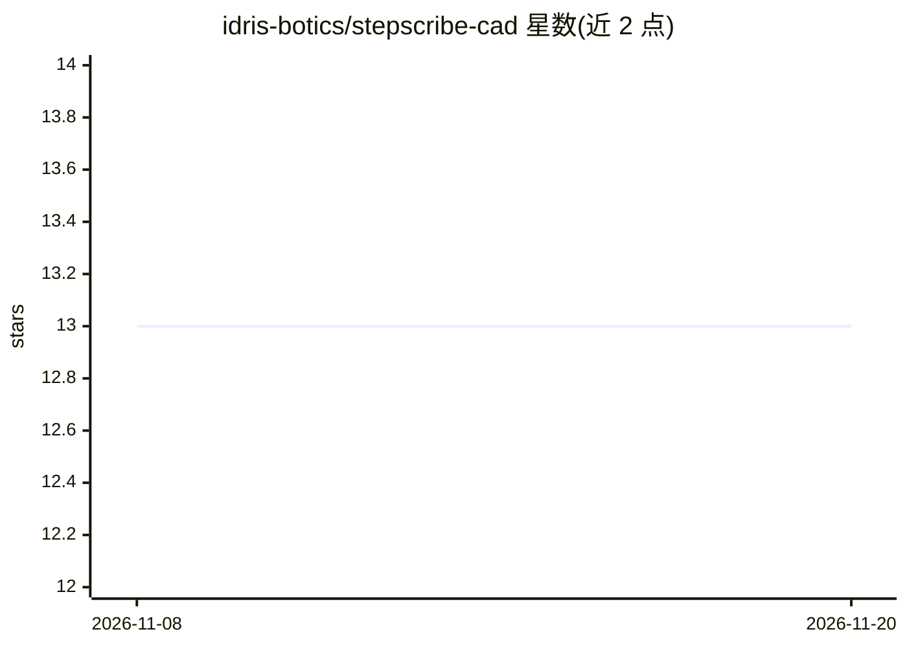

# idris-botics/stepscribe-cad

⭐ 13 · Python · AGPL-3.0 · 推送 2026-11-10 · [GitHub](https://github.com/idris-botics/stepscribe-cad) · 个人维护

**为设计新手把 STEP CAD 文件转为 LLM 可读上下文包**

读取 STEP 文件并用 OpenCASCADE 内核做确定性计算，离线生成含精确尺寸、孔位、切口、标准件、装配关系、关节、弱点与标注图像的 LLM 上下文包（FULL/COMPACT/SMALL 多档 token 预算）。输出为本地 Markdown/JSON/图像文件，用户自行粘贴或上传到任意 AI 聊天，或经 Claude Code 插件、Agent Skill、Copilot、MCP 服务器接入。设计评判层由用户自己的 LLM 在工具外部完成；工具本身不含 AI 模型、不联网。

## 筛选速览

| 维度 | 判定 | 备注 |
|---|---|---|
| AI 角色 | `ai-ecosystem` | LLM/agent 周边工具 |
| 许可风险 | `dual` | AGPL-3.0 |
| 部署形态 | `desktop` | 安装包/桌面程序 |
| 模型依赖 | — | README 未给出锁定关系 |
| 硬件要求 | — | 无带数字的原话,不猜 |
| 安装摩擦 | `low` | 无编译、无系统依赖或容器化 |
| 成熟度 | — | 结构信号不足 |

## 能力要点

- 离线确定性解析 STEP：测量、孔位、装配关系、DH 表与 URDF 草稿
- 按 token 预算输出 FULL/COMPACT/SMALL 三档上下文文件与 chat_bundle
- Claude Code 插件提供 export/interview/review 三条命令
- MCP 服务器暴露 17 个工具，结果按文件哈希缓存

## 适用场景

- 把机器人模型的结构与关节信息交给 Claude Code 做设计评审
- 向 ChatGPT 粘贴 Markdown 包讲解自己的 CAD 装配
- 为本地小模型准备 SMALL 档上下文与图像

## 场景标签

`文档解析` · 领域:知识与检索

## 证据(README 行号)

> L3: Give any LLM X-ray vision into your CAD model. `stepscribe` reads a STEP file and writes an **LLM context pack**: ex
> L37: - Everything runs on your computer: no AI model, no network, no upload.
> L162: Layers 1 and 2 (measure, interpret) are pure Python on the OpenCASCADE kernel: deterministic, offline, explainable

## 星数曲线

2026-11-08 13 → 2026-11-20 13（+0）

---
*卡片 v1 · prompt 1.4 · 生成 2026-11-18 · 置信度 high · 依据 README sha `605fae86e508` · [字段定义](../../DATASET.md)*
