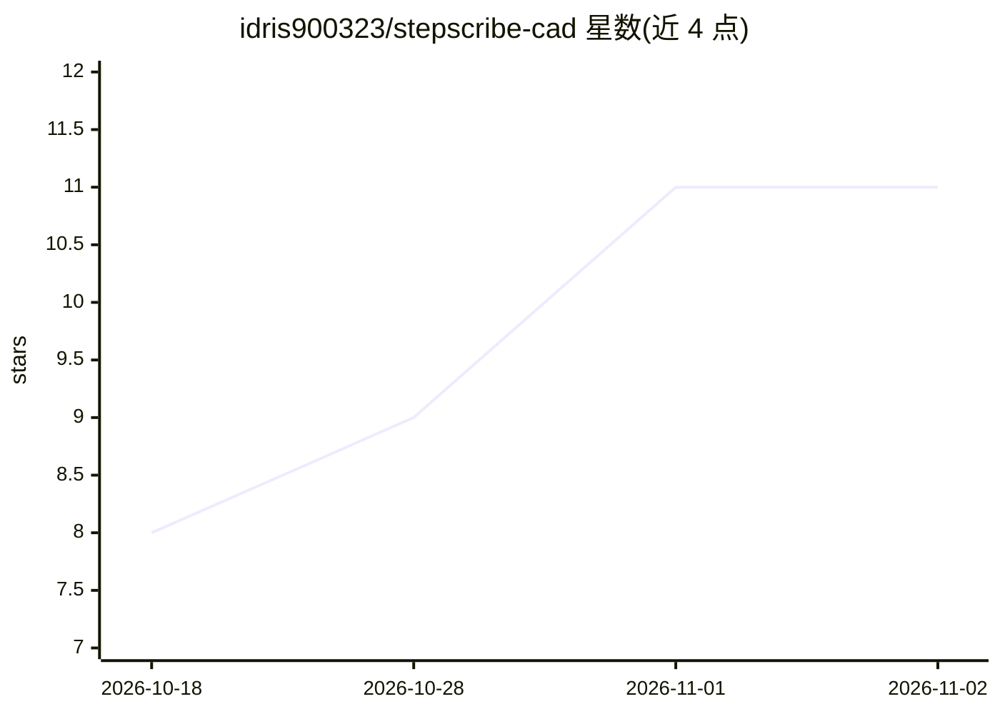

# idris900323/stepscribe-cad

⭐ 11 · Python · AGPL-3.0 · 推送 2026-11-01 · [GitHub](https://github.com/idris900323/stepscribe-cad) · 个人维护

**离线解析 STEP CAD 文件并生成 LLM 上下文包的工具**

读取 STEP 文件，基于 OpenCASCADE 内核以纯 Python 确定性地测量面、孔位、特征、装配关系、运动学与薄弱点，输出多文件 Markdown 上下文包、标注图像与 report.json，供粘贴进任意 AI 聊天使用。提供 CLI、本地网页界面、Claude Code 插件、Agent Skill 与 MCP 服务器四种接入方式。全部计算离线完成，本体不含 AI 模型，设计判断由用户自己的 LLM 完成。需 Python 3.11+。

## 筛选速览

| 维度 | 判定 | 备注 |
|---|---|---|
| AI 角色 | `ai-ecosystem` | LLM/agent 周边工具 |
| 许可风险 | `dual` | AGPL-3.0 |
| 部署形态 | `desktop` | 安装包/桌面程序 |
| 模型依赖 | local-ok | 支持本地模型 |
| 硬件要求 | — | 无带数字的原话,不猜 |
| 安装摩擦 | `low` | 无编译、无系统依赖或容器化 |
| 成熟度 | — | 结构信号不足 |

## 能力要点

- 从 STEP 文件生成 FULL/COMPACT/SMALL 三档 token 预算的 Markdown 上下文包与标注图像
- 规则化的理解层：推测工艺、运动副、自由度、薄弱点与载荷路径，各带置信度与证据
- 提供 Claude Code 插件、GitHub Copilot、MCP 服务器与 Agent Skill 接入
- 本地网页界面支持上传、进度估计、分页浏览与设计师问答

## 适用场景

- 把 CAD 模型转成 Markdown 文件贴给 ChatGPT/Claude 等聊天 AI 获得设计建议
- 在 Claude Code 内通过斜杠命令导出上下文包并获得设计评审
- 对装配体做薄弱点与运动学检查并生成带证据的报告

## 场景标签

`文档解析` · 领域:知识与检索

## 证据(README 行号)

> L3: Give any LLM X-ray vision into your CAD model. `stepscribe` reads a STEP file and writes an **LLM context pack**: ex
> L144: Layers 1 and 2 (measure, interpret) are pure Python on the OpenCASCADE kernel: deterministic, offline, explainable

## 星数曲线

2026-10-18 8 → 2026-11-02 11（+3）

---
*卡片 v1 · prompt 1.4 · 生成 2026-11-02 · 置信度 high · 依据 README sha `e8674447af44` · [字段定义](../../DATASET.md)*
