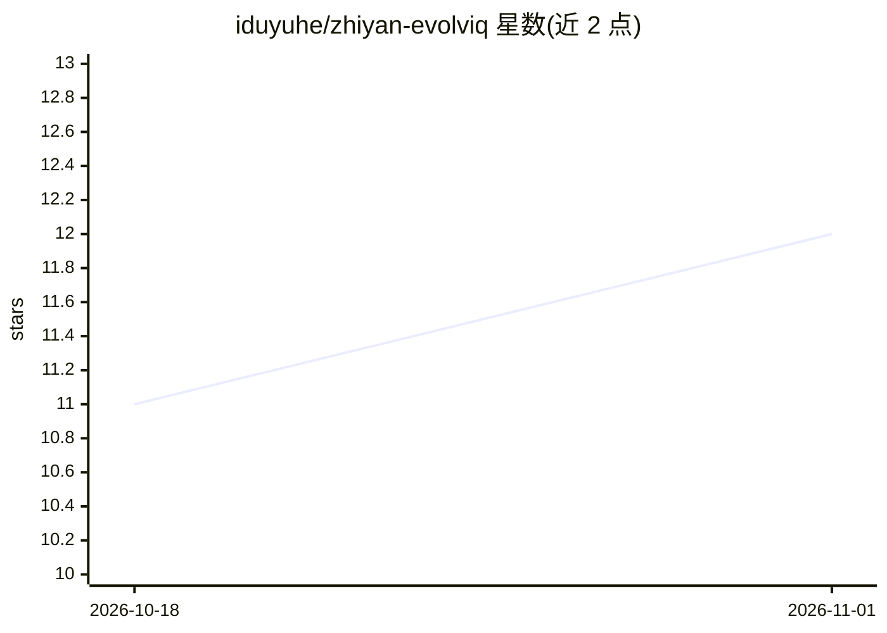

# iduyuhe/zhiyan-evolviq

⭐ 12 · Python · Apache-2.0 · 推送 2026-10-17 · [GitHub](https://github.com/iduyuhe/zhiyan-evolviq) · [官网](https://github.com/iduyuhe/zhiyan-evolviq) · 组织维护 · 中文 README

**面向电子制造与半导体的开源工业 Agent 平台**

以 FastAPI 为基础的 AI-Native 工业 Agent 平台，预置 25 个覆盖车间操作、企业经营决策与平台治理的 Agent（供应链齐套、良率分析、质量追溯、DFM 检查、OEE、预测维护等）。提供 65 个 MCP 工具联邦（HTTP + stdio 双传输）、Modbus/MQTT/OPC-UA/IPC-CFX 四种工业协议网关（真实或仿真模式）、8 个多 Agent 协作模板与 Neo4j 跨 Agent 知识图谱。支持经验记忆回写、人工审批干预、自助式降级（无 PostgreSQL/Neo4j 时用 SQLite + 内存图运行）。Apache-2.0 许可，提供本地 Python 与 Docker Compose 两种启动方式。

## 筛选速览

| 维度 | 判定 | 备注 |
|---|---|---|
| AI 角色 | `ai-ecosystem` | LLM/agent 周边工具 |
| 许可风险 | `permissive` | Apache-2.0 |
| 部署形态 | `self-host` | docker 或自建部署 |
| 模型依赖 | — | README 未给出锁定关系 |
| 硬件要求 | — | 无带数字的原话,不猜 |
| 安装摩擦 | `low` | 无编译、无系统依赖或容器化 |
| 成熟度 | — | 结构信号不足 |

## 能力要点

- 25 个预置工业 Agent，覆盖车间/决策/治理三层
- 65 个 MCP 工具联邦（HTTP + stdio 双传输）
- Modbus/MQTT/OPC-UA/IPC-CFX 四种工业协议网关，真实或仿真模式
- 8 个多 Agent 协作模板，含零 LLM 成本的预设路径

## 适用场景

- 电子制造/半导体企业的产线质量追溯与良率分析
- 用自然语言目标触发多 Agent 协作（如提升 OEE、NPI 全评估）
- 通过 OPC-UA/Modbus/MQTT 网关接入产线设备数据

## 场景标签

`Agent 框架` `多智能体` `知识图谱` · 领域:Agent 开发

## 证据(README 行号)

> L3: > **The world's first open-source, AI-native industrial agent platform** — 25 pre-built agents spanning L2 (shop-flo
> L19: - **25 Industrial Agents**: Pre-built autonomous agents for supply chain, R&D, manufacturing, quality, and enterpri
> L22: - **Multi-Agent Orchestration**: 8 preset collaboration templates (NPI / OEE / Quality / Energy / ECO ...) — automa

## 星数曲线

2026-10-18 11 → 2026-11-01 12（+1）

---
*卡片 v1 · prompt 1.4 · 生成 2026-11-01 · 置信度 high · 依据 README sha `c906aefce793` · [字段定义](../../DATASET.md)*
