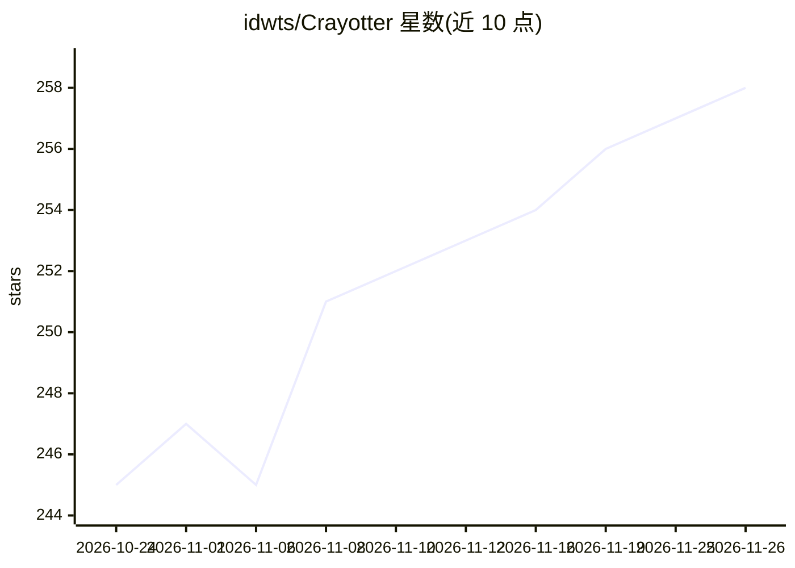

# idwts/Crayotter

⭐ 258 · Python · NOASSERTION · 推送 2026-10-31 · [GitHub](https://github.com/idwts/Crayotter) · [官网](https://idwts.github.io/Crayotter/) · 个人维护 · 中文 README

**文字需求到成片的端到端 AI 视频剪辑智能体**

多模态智能体驱动的视频剪辑系统：输入一条自然语言需求，自动完成素材搜索与下载（Bilibili、抖音、小红书、快手、YouTube 等多源，经 yt-dlp）、素材多模态分析、剪辑蓝图推理、ReAct 工具执行，产出带旁白 TTS、字幕、混音的成品视频。三阶段工作流全程留日志并支持可视化 trace 与断点续跑。桌面版提供 Windows 与 Apple Silicon 安装包，也可源码运行；模型 API key 需用户自备，采用 PolyForm Noncommercial 非商业许可。

## 筛选速览

| 维度 | 判定 | 备注 |
|---|---|---|
| AI 角色 | `ai-native` | 本体是模型或模型工具 |
| 许可风险 | `none` | NOASSERTION |
| 部署形态 | `desktop` | 安装包/桌面程序 |
| 模型依赖 | — | README 未给出锁定关系 |
| 硬件要求 | — | 无带数字的原话,不猜 |
| 安装摩擦 | `medium` | 含编译或系统依赖之一 |
| 成熟度 | — | 结构信号不足 |

## 能力要点

- 一条自然语言请求驱动素材采集到导出的全流程
- 三阶段可追溯工作流：规划→纯推理剪辑研究→工具执行
- 资源感知 DAG 调度与中断任务恢复
- 内置分段 TTS、响度归一、字幕烧录与背景闪避

## 适用场景

- 输入一句话描述，让 agent 自动生成带旁白字幕的成片
- 从 B 站、抖音、YouTube 等平台采集素材二次剪辑
- 回放可视化 trace 检查剪辑 agent 的工具调用过程

## 场景标签

`视频生成` `多模态` · 领域:内容生成

## 证据(README 行号)

> L28: Crayotter is a multimodal, agent-driven video editing system that turns a single text request into a complete edite
> L57: - **One request to one video** — A single natural-language prompt drives the whole pipeline from sourcing to export
> L133: 1. **Set up models:** open Settings and enter your API key, endpoint, and models. Provider charges apply; Crayotte

## 星数曲线

2026-10-24 245 → 2026-11-26 258（+13）

---
*卡片 v1 · prompt 1.4 · 生成 2026-11-25 · 置信度 high · 依据 README sha `84f34ff3bfdf` · [字段定义](../../DATASET.md)*
