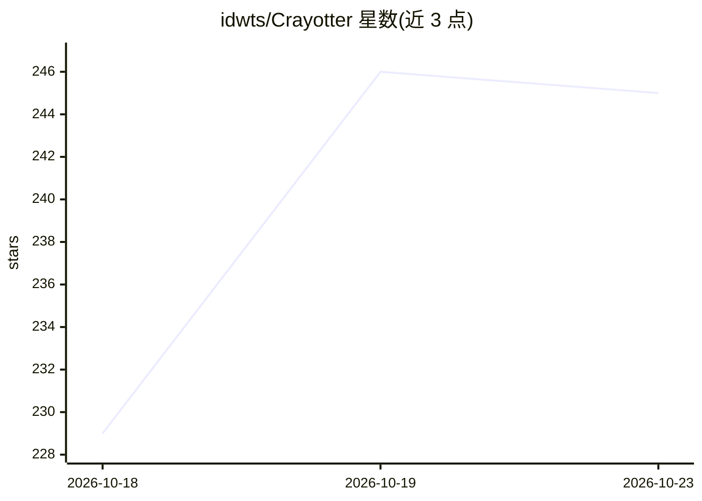

# idwts/Crayotter

⭐ 245 · Python · NOASSERTION · 推送 2026-10-12 · [GitHub](https://github.com/idwts/Crayotter) · [官网](https://idwts.github.io/Crayotter/) · 组织维护 · 中文 README

**多模态 AI 剪辑智能体：一句话文字需求端到端产出成品视频**

基于多模态大模型的视频剪辑 agent 系统：接收一行自然语言需求后，经三阶段工作流（素材准备→剪辑研究→ReAct 剪辑执行）自动完成搜索下载、多模态素材分析、剪辑蓝图生成、切条、TTS 旁白、字幕烧录与导出。支持 Bilibili/抖音/小红书/快手/YouTube 等多源素材导入，配 Web 工作台与轨迹可视化。默认接入 OpenAI 兼容 API（dashscope/qwen-plus），需自行配置 API key；源码运行需 Python 3.10+ 与 ffmpeg，Windows 提供免安装独立发行包。

## 筛选速览

| 维度 | 判定 | 备注 |
|---|---|---|
| AI 角色 | `ai-native` | 本体是模型或模型工具 |
| 许可风险 | `none` | NOASSERTION |
| 部署形态 | `desktop` | 安装包/桌面程序 |
| 模型依赖 | — | README 未给出锁定关系 |
| 硬件要求 | — | 无带数字的原话,不猜 |
| 安装摩擦 | `medium` | 含编译或系统依赖之一 |
| 成熟度 | — | 结构信号不足 |

## 能力要点

- 三阶段可回放工作流：规划、纯推理剪辑研究、工具化执行
- 资源感知 DAG 调度：搜索/下载/分析/LLM/FFmpeg/TTS 有界并发，支持断点续跑
- 多源素材导入（Bilibili/抖音/小红书/快手/YouTube/generic URL）
- 内置分段 TTS、响度归一、背景闪避与字幕烧录

## 适用场景

- 用一句话需求自动生成完整剪辑视频
- 本地素材优先的自动化剪辑与配旁白字幕
- 通过 Web 工作台管理任务并回放工具调用轨迹做调试

## 场景标签

`视频生成` · 领域:内容生成

## 证据(README 行号)

> L28: Crayotter is a multimodal, agent-driven video editing system that turns a single text request into a complete edite
> L57: - **Multimodal material understanding** — Each source video is analyzed by a multimodal model to inform narrative a

## 星数曲线

2026-10-18 229 → 2026-10-23 245（+16）

---
*卡片 v1 · prompt 1.4 · 生成 2026-10-22 · 置信度 mid · 依据 README sha `857504bf9fae` · [字段定义](../../DATASET.md)*
