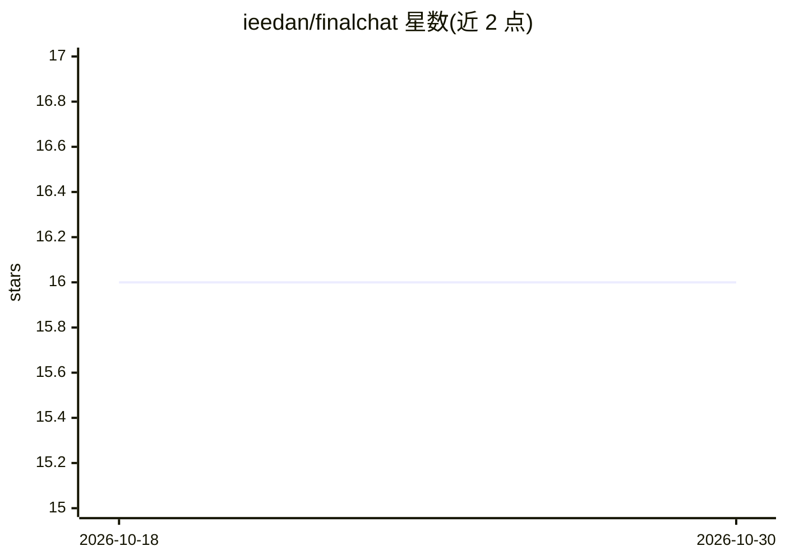

# ieedan/finalchat

⭐ 16 · Svelte · MIT · 推送 2026-10-15 · [GitHub](https://github.com/ieedan/finalchat) · [官网](https://finalchat.app) · 个人维护

**开源聊天应用：接入 OpenRouter 自带密钥对话**

面向终端用户的聊天应用，用户携带自己的 OpenRouter API Key 使用多种模型进行对话，支持图片生成与上传、链接读取（GitHub 等站点自定义处理）、消息与标题全文搜索、聊天分享、快捷键，并区分基础/高级两种控制模式。作者声明其为闭源项目 thom.chat 与 comprably.ai 之后的开源版本，提供在线站点 finalchat.app，支持通过 q 参数从外部带入提示词。技术栈为 SvelteKit、Convex、WorkOS、R2、shadcn-svelte，README 未给出本地部署或安装命令。

## 筛选速览

| 维度 | 判定 | 备注 |
|---|---|---|
| AI 角色 | `ai-native` | 本体是模型或模型工具 |
| 许可风险 | `permissive` | MIT |
| 部署形态 | `None` |  |
| 模型依赖 | locked-api |  |
| 硬件要求 | — | 无带数字的原话,不猜 |
| 安装摩擦 | `low` | 无编译、无系统依赖或容器化 |
| 成熟度 | — | 结构信号不足 |

## 能力要点

- 自带 OpenRouter Key 接入多模型（含图片模型）
- 图片上传/生成与链接读取（GitHub 等站点自定义处理）
- 消息内容与聊天标题的全文搜索、聊天分享
- 基础/高级双模式与全量快捷键，支持移动端使用

## 适用场景

- 用自己的 API Key 在网页端与多种模型对话
- 在桌面与移动设备上使用同一聊天应用
- 通过 URL 参数把提示词带入应用开始对话

## 场景标签

`聊天机器人` · 领域:对话与助手

## 证据(README 行号)

> L17: - Bring your own key from OpenRouter
> L21: - Upload and generate images

## 星数曲线

2026-10-18 16 → 2026-10-30 16（+0）

---
*卡片 v1 · prompt 1.4 · 生成 2026-10-30 · 置信度 high · 依据 README sha `abb5feeeca69` · [字段定义](../../DATASET.md)*
