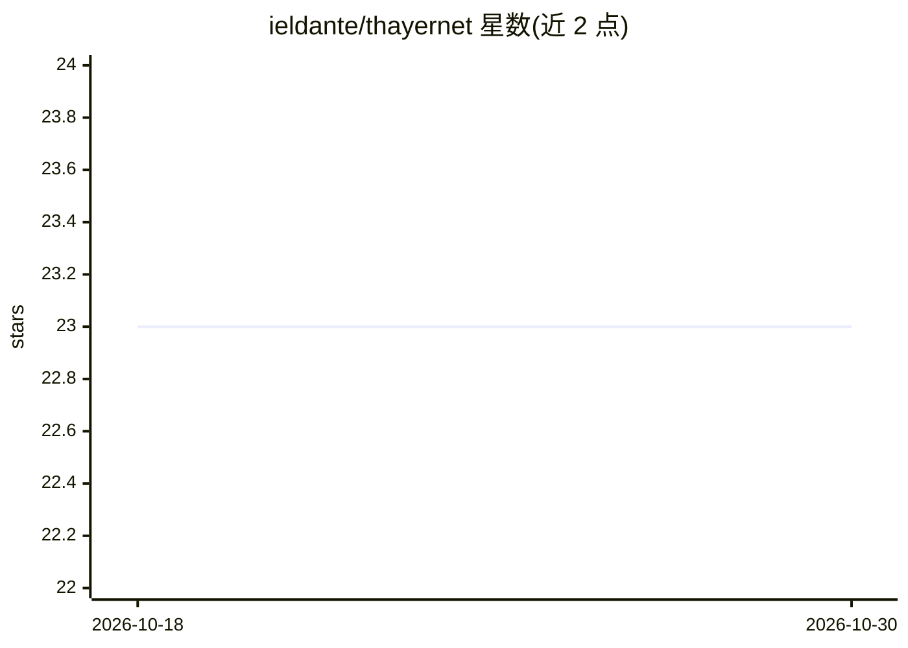

# ieldante/thayernet

⭐ 23 · Python · Apache-2.0 · 推送 2026-07-19 · [GitHub](https://github.com/ieldante/thayernet) · 个人维护

**紧凑 U-Net 研究测试床：从合成混叠图中重建目标星系图像**

基于 U-Net 的图像到图像重建模型研究仓库，使用 Galaxy10 DECaLS 切片构建受控合成混叠基准，研究学习模型能否比简单非学习基线更准确地重建已知目标星系。提供 Thayer-Direct、Thayer-Residual、Thayer-BR 系列等多个模型变体，当前参考为 Thayer-BR v0.2 Moderate 分组重训练版。数据集需单独下载 Galaxy10 DECaLS HDF5 文件，通过 venv + pip 安装依赖后在 JupyterLab 中运行 notebook 与 scripts 工作流。README 明确声明这是受控合成基准而非巡天级去混叠管线，结果不可解释为真实巡天性能。

## 筛选速览

| 维度 | 判定 | 备注 |
|---|---|---|
| AI 角色 | `ai-native` | 本体是模型或模型工具 |
| 许可风险 | `permissive` | Apache-2.0 |
| 部署形态 | `library` | 以包/库形式分发 |
| 模型依赖 | — | README 未给出锁定关系 |
| 硬件要求 | — | 无带数字的原话,不猜 |
| 安装摩擦 | `low` | 无编译、无系统依赖或容器化 |
| 成熟度 | `idea` | |

## 能力要点

- U-Net 直接重建与残差预测两种建模方式及多个消融变体
- 精确像素/坐标分组不相交的训练-验证-测试划分，附来源泄漏审计
- 受影响区域指标与整图指标双轨评估，含 identity 与阈值基线
- 固定种子合成混叠生成与检查点完整性日志

## 适用场景

- 在受控合成数据上研究星系去混叠的深度学习基线
- 复现或扩展分组不相交的评估协议与消融实验
- 作为图像到图像天文重建的科研测试床

## 场景标签

`图像视频处理` `科研工具` · 领域:学习与行业

## 证据(README 行号)

> L3: Thayer-Net is a compact U-Net research testbed for controlled synthetic galaxy
> L4: deblending with Galaxy10 DECaLS cutouts. It asks whether learned image-to-image
> L59: - **Thayer-Direct:** direct reconstruction U-Net, trained to map
> L60:  `blended -> target`.

## 星数曲线

2026-10-18 23 → 2026-10-30 23（+0）

---
*卡片 v1 · prompt 1.4 · 生成 2026-10-27 · 置信度 mid · 依据 README sha `ecb24bcc6d3e` · [字段定义](../../DATASET.md)*
