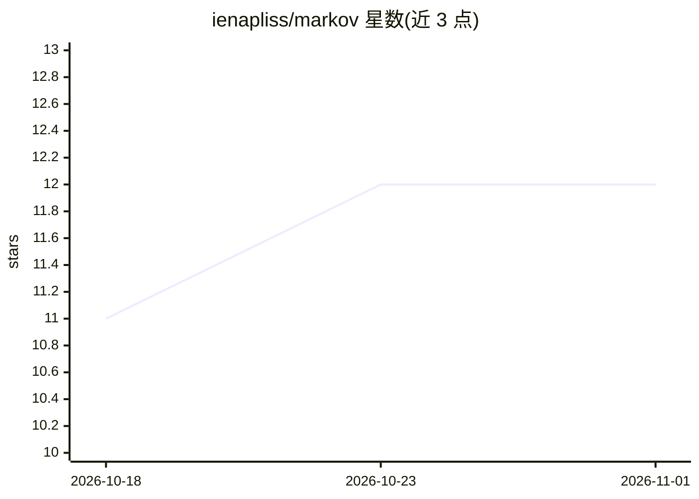

# ienapliss/markov

⭐ 12 · Shell · MIT · 推送 2026-10-31 · [GitHub](https://github.com/ienapliss/markov) · 个人维护

**单文件 Bash 脚本实现的通用 LLM harness 与编码 agent**

以单个可修改的 Bash 脚本实现的通用 LLM harness 与编码 agent，依赖仅 curl、jq 与常见 Unix 工具，要求 Bash 5+。提供多 thread 会话、同步子 agent 委派、懒加载工具、运行时可自改写并热重载的 module 机制、基础 MCP 支持（Streamable HTTP 与 stdio）、whisper+sox 语音转文字。兼容 OpenAI Chat Completions/Responses 与 Anthropic 流式 API，重度面向 llama.cpp 本地后端。默认不对 Bash 命令与工具执行做验证限制，文档尚在完善中。

## 筛选速览

| 维度 | 判定 | 备注 |
|---|---|---|
| AI 角色 | `ai-ecosystem` | LLM/agent 周边工具 |
| 许可风险 | `permissive` | MIT |
| 部署形态 | `None` |  |
| 模型依赖 | — | README 未给出锁定关系 |
| 硬件要求 | — | 无带数字的原话,不猜 |
| 安装摩擦 | `low` | 无编译、无系统依赖或容器化 |
| 成熟度 | `idea` | |

## 能力要点

- 单 Bash 脚本实现，依赖仅 curl、jq 与 Unix 工具（Bash 5+）
- 同步 sub-agent 子线程委派与懒加载工具（不破坏缓存前缀）
- module 可运行时自改写并 /reload 热加载
- 基础 MCP 支持（Streamable HTTP / stdio）与 whisper 语音转文字

## 适用场景

- 在本地 llama.cpp 后端上跑一个轻量编码 agent
- 通过 `!`/`!!` 直接在运行进程内检查和修改 harness 状态
- 用 module 脚本按需扩展 slash 命令与工具

## 场景标签

`编码 Agent` · 领域:编码与开发

## 证据(README 行号)

> L3: A general-purpose LLM harness and coding agent implemented as a single,
> L8: `Markov` works with just `curl`, [jq], and very common Unix utilities as its
> L168: `markov` is a general-purpose LLM harness and coding agent implemented as a

## 星数曲线

2026-10-18 11 → 2026-11-01 12（+1）

---
*卡片 v1 · prompt 1.4 · 生成 2026-11-01 · 置信度 high · 依据 README sha `f5241b580164` · [字段定义](../../DATASET.md)*
