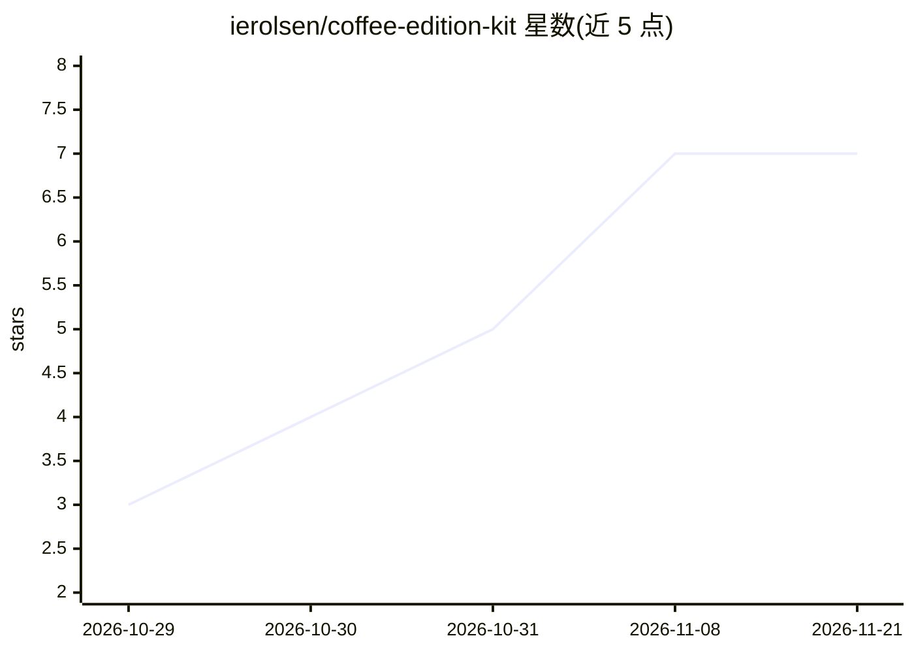

# ierolsen/coffee-edition-kit

⭐ 7 · Python · MIT · 推送 2026-10-23 · [GitHub](https://github.com/ierolsen/coffee-edition-kit) · [官网](https://erolsen.dev/writing/coffee-edition) · 个人维护

**每晚由 Claude 从你的笔记写报纸并由树莓派 Pico 自动打印**

个人自动化流水线：notes/ 文件夹中的 Markdown 笔记每晚由 Claude 例程写成两页报纸 JSON，GitHub Actions 用 headless Chrome 排版成三栏并逐页校验（列内换行、页数上限、PDF 字符完整性），转换为 PDF/PWG 光栅/JPEG 后放入 queue 分支；Pico W 每 5 分钟轮询并按设定时间通过 IPP 打印。可选 Fresh Ink 页面从 Hugging Face、arXiv、GitHub trending 等来源汇总 AI 新方法并核对数字。写作者不浏览网页，内容质量取决于笔记本身；目前仅支持 A4，不支持 URF 光栅打印机。

## 筛选速览

| 维度 | 判定 | 备注 |
|---|---|---|
| AI 角色 | `ai-native` | 本体是模型或模型工具 |
| 许可风险 | `permissive` | MIT |
| 部署形态 | `None` |  |
| 模型依赖 | locked-api |  |
| 硬件要求 | — | 无带数字的原话,不猜 |
| 安装摩擦 | `low` | 无编译、无系统依赖或容器化 |
| 成熟度 | — | 结构信号不足 |

## 能力要点

- Claude 例程夜间写作 + GitHub Actions 排版校验 + Pico W 无人值守打印的三段式流水线
- Fresh Ink 页面汇总 5-17 条 AI 新方法，每个数字与图表值对照来源核验
- Pico 仅发起出站请求，不开放入站访问；token 权限限定单一仓库
- 支持多语言输出（通过 labels.json 与 STYLE.md 配置）

## 适用场景

- 每天早晨从打印机取一份由自己笔记生成的报纸
- 持续追踪 Hugging Face 与 arXiv 上的新 AI 方法并打印摘要
- 为家人或团队定期把笔记以纸质形式输出

## 场景标签

`工作流自动化` · 领域:效率与自动化

## 证据(README 行号)

> L9: You keep notes in a folder. Every night a Claude routine turns the next one into an issue, GitHub Actions lays it ou
> L36: 1. **The writer.** A Claude routine runs a few hours before the print time. It picks the next unprinted note, reads
> L17: **Fresh Ink, if you follow AI.** With `"radar": true` in `printer.json`, every issue gets one to four more pages at

## 星数曲线

2026-10-29 3 → 2026-11-21 7（+4）

---
*卡片 v1 · prompt 1.4 · 生成 2026-11-20 · 置信度 high · 依据 README sha `5aac134930bc` · [字段定义](../../DATASET.md)*
