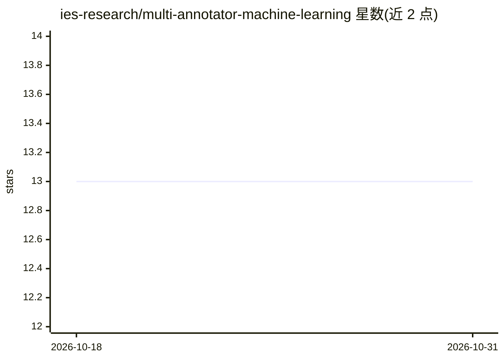

# ies-research/multi-annotator-machine-learning

⭐ 13 · Python · BSD-3-Clause · 推送 2026-08-23 · [GitHub](https://github.com/ies-research/multi-annotator-machine-learning) · 组织维护

**多标注者噪声标签学习框架：从众包标注训练分类模型**

基于 PyTorch / PyTorch Lightning / Hydra 的多标注者学习生态系统：实现 Dawid-Skene、crowd layer、Annot-Mix 等 10 种估计标注者性能的监督学习方法，从多名易错（多为人类）标注者提供的噪声标注中训练分类模型。提供 7 个公开众标数据集（含文本/声音/图像模态）的下载与训练代码、实验脚本、Jupyter Notebook 结果分析与 SLURM 批处理支持，实验结果经 MLflow 记录。假定 Linux 操作系统，通过 conda 环境安装；由卡塞尔大学研究者维护，支撑 ECAI 2024、NeurIPS 2024、TMLR 2025 三篇论文。

## 筛选速览

| 维度 | 判定 | 备注 |
|---|---|---|
| AI 角色 | `ai-native` | 本体是模型或模型工具 |
| 许可风险 | `permissive` | BSD-3-Clause |
| 部署形态 | `None` |  |
| 模型依赖 | — | README 未给出锁定关系 |
| 硬件要求 | — | 无带数字的原话,不猜 |
| 安装摩擦 | `low` | 无编译、无系统依赖或容器化 |
| 成熟度 | — | 结构信号不足 |

## 能力要点

- 实现 10 种多标注者学习方法（1979–2024 年论文来源）
- 内置 7 个众标数据集的下载与训练代码及噪声变体
- 提供实验脚本、Jupyter 结果分析与 SLURM 批处理执行
- 实验结果通过 MLflow 记录管理

## 适用场景

- 在含多名标注者噪声标签的数据集上训练分类模型
- 对比或复现多标注者学习方法的基准实验
- 复现 annot-mix / dopanim / crowd-hpo 论文实验

## 场景标签

`科研工具` · 领域:学习与行业

## 证据(README 行号)

> L12: This project implements an ecosystem for multi-annotator learning approaches, aiming to learn from data with
> L26: Multi-annotator learning approaches estimate annotators' performances for improving neural networks' generalization
> L162: - `maml`: Python package for multi-annotator machine learning consisting of several sub-packages

## 星数曲线

2026-10-18 13 → 2026-10-31 13（+0）

---
*卡片 v1 · prompt 1.4 · 生成 2026-10-31 · 置信度 high · 依据 README sha `3a8d701e3fd9` · [字段定义](../../DATASET.md)*
