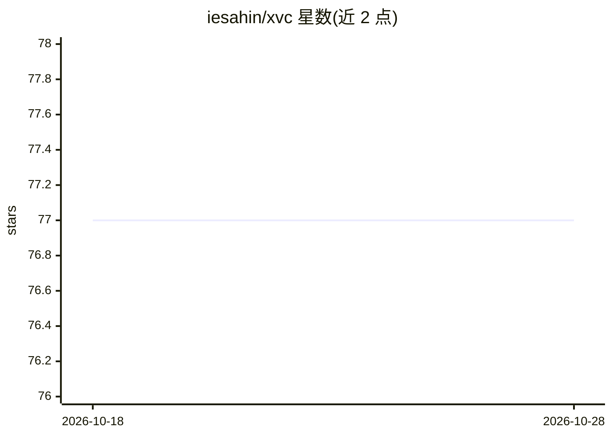

# iesahin/xvc

⭐ 77 · Rust · GPL-3.0 · 推送 2026-10-28 · [GitHub](https://github.com/iesahin/xvc) · 个人维护

**Rust 编写的 Git 内数据与管道版本管理命令行工具（MLOps）**

面向机器学习工程的数据与管道管理工具：在 Git 仓库旁跟踪二进制数据文件，计算 BLAKE-3 内容哈希存入内容寻址缓存，支持以 symlink/hardlink/reflink 方式检出子集；可将数据发送至 S3、GCS、MinIO、Cloudflare R2、Wasabi、DigitalOcean Spaces、Dropbox、Rsync、Rclone 等存储并限时分享链接。另提供管道功能：定义步骤命令与多种依赖（文件、glob、行区间、正则、URL、YAML/JSON 参数、SQLite 查询、自定义命令），仅依赖变化时重跑，无相互依赖的步骤可并行。Git 非必需，凭据不由工具存储。通过 cargo、pip 或发布页二进制安装。

## 筛选速览

| 维度 | 判定 | 备注 |
|---|---|---|
| AI 角色 | `ai-ecosystem` | LLM/agent 周边工具 |
| 许可风险 | `viral` | GPL-3.0 |
| 部署形态 | `library` | 以包/库形式分发 |
| 模型依赖 | — | README 未给出锁定关系 |
| 硬件要求 | — | 无带数字的原话,不猜 |
| 安装摩擦 | `low` | 无编译、无系统依赖或容器化 |
| 成熟度 | — | 结构信号不足 |

## 能力要点

- BLAKE-3 内容哈希与内容寻址缓存跟踪大数据文件，无需复制到所有 Git 克隆
- 支持 S3/GCS/MinIO/R2/Wasabi/Dropbox/Rsync/Rclone 等多种云存储及自定义命令式存储
- 管道步骤支持文件/glob/行区间/正则/URL/参数/SQLite 查询等细粒度依赖，变化才重跑
- 依赖变化项可通过环境变量注入步骤命令，仅处理新增文件/行

## 适用场景

- 把训练数据、模型等大文件与代码一起版本化而不膨胀 Git 仓库
- 在团队成员间通过云存储共享项目数据并按需检出子集
- 数据或参数变化时自动重跑预处理、训练等管道步骤

## 场景标签

`MLOps` · 领域:训练与推理

## 证据(README 行号)

> L8: Manage your data next to code in Git repositories and run commands when they change.
> L26: - You want to [specify commands][xvc-p-s-n] that [run][xvc-p-r] when
> L27: only input data changes, define [pipelines][xvc-p-n] with steps that

## 星数曲线

2026-10-18 77 → 2026-10-28 77（+0）

---
*卡片 v1 · prompt 1.4 · 生成 2026-10-24 · 置信度 mid · 依据 README sha `5f3d4e5d8aac` · [字段定义](../../DATASET.md)*
