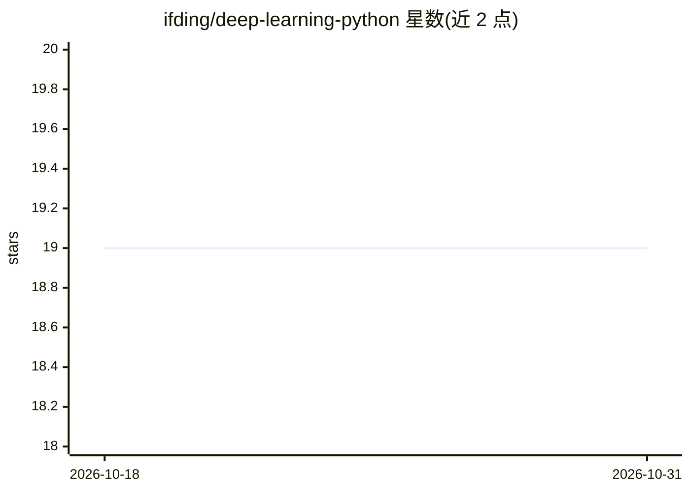

# ifding/deep-learning-python

⭐ 19 · Python · MIT · 推送 2026-07-17 · [GitHub](https://github.com/ifding/deep-learning-python) · 个人维护

**自动驾驶方向的深度学习与计算机视觉学习项目集**

个人学习性质的项目集合，记录用 Python/C++/OpenCV 实现的深度学习与计算机视觉实验：高速公路车道线检测（Hough 变换与 Canny 边缘检测）、基于 SVM 与 dlib 的交通标志分类、OpenCV DNN 目标检测、HOG+SVM 与深度网络的车辆检测跟踪、全卷积网络的道路分割，另含 Faster-RCNN & PyTorch 训练目标检测器的条目与自动驾驶系统组件笔记。README 未提供安装与运行说明，末尾列出 learnopencv 与 self-driving-car 两个参考仓库。

## 筛选速览

| 维度 | 判定 | 备注 |
|---|---|---|
| AI 角色 | `ai-knowledge` | 知识聚合/清单类 |
| 许可风险 | `permissive` | MIT |
| 部署形态 | `None` |  |
| 模型依赖 | — | README 未给出锁定关系 |
| 硬件要求 | — | 无带数字的原话,不猜 |
| 安装摩擦 | `low` | 无编译、无系统依赖或容器化 |
| 成熟度 | — | 结构信号不足 |

## 能力要点

- 5 个计算机视觉/深度学习项目实现记录（车道线检测、交通标志分类、目标检测、车辆检测跟踪、道路分割）
- 涵盖 OpenCV 传统方法（Hough/Canny/HOG）与深度网络（FCN、Faster-RCNN）
- 含自动驾驶系统组件与数据集基础笔记

## 适用场景

- 学习自动驾驶相关的计算机视觉经典项目实现
- 了解 OpenCV 传统视觉方法与深度学习方法的组合用法
- 作为 FCN 语义分割与 HOG+SVM 检测的参考示例

## 场景标签

`图像视频处理` `目标检测` `教程课程` · 领域:学习与行业

## 证据(README 行号)

> L1: # Deep Learning using Python/C++/OpenCV
> L12: #### P1 - Detecting Lane Lines
> L16: #### P2 - Traffic Sign Classification
> L20: #### P3 - Object Detection with OpenCV

## 星数曲线

2026-10-18 19 → 2026-10-31 19（+0）

---
*卡片 v1 · prompt 1.4 · 生成 2026-10-28 · 置信度 high · 依据 README sha `e2019bfc8ef1` · [字段定义](../../DATASET.md)*
