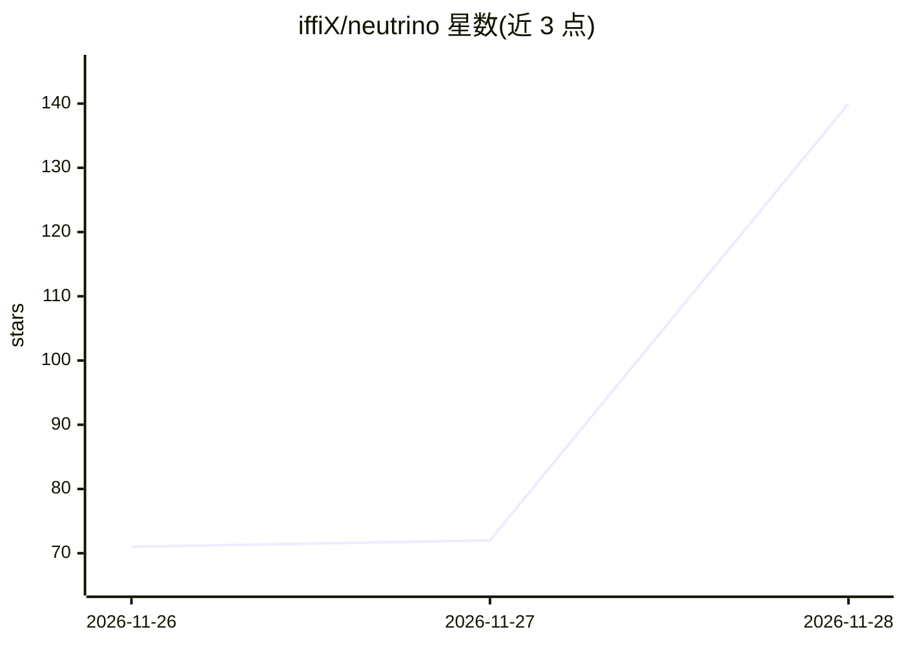

# iffiX/neutrino

⭐ 140 · Python · MIT · 推送 2026-11-27 · [GitHub](https://github.com/iffiX/neutrino) · [官网](https://neutrinohub.net/) · 个人维护 · 中文 README

**在个人电脑上一键部署 AI 应用并远程访问的面板**

一个部署在用户已有 Windows/macOS/Linux 电脑上的面板，将 Claude Code、Codex、AstrBot、Ollama、code-server 等应用一键安装并统一管理，内置 AI 网关集中配置 API 密钥与模型。配套客户端支持手机/桌面远程访问，提供 6 种加密连接方式、应用链接分享、多机管理与凭据保管。支持自声明服务与容器接入，提供国内版安装源，未部署应用时也可作为系统工具面板使用。

## 筛选速览

| 维度 | 判定 | 备注 |
|---|---|---|
| AI 角色 | `ai-ecosystem` | LLM/agent 周边工具 |
| 许可风险 | `permissive` | MIT |
| 部署形态 | `None` |  |
| 模型依赖 | local-ok | 支持本地模型 |
| 硬件要求 | — | 无带数字的原话,不猜 |
| 安装摩擦 | `low` | 无编译、无系统依赖或容器化 |
| 成熟度 | — | 结构信号不足 |

## 能力要点

- 一键安装 Claude Code、Codex、Ollama、AstrBot 等应用并统一面板管理
- AI 网关集中配置提供方密钥，多台电脑上的 AI 工具共享
- 手机扫码远程访问，6 种加密连接方式与智能路由
- 网页应用可生成到期失效、可收回的分享链接

## 适用场景

- 在手机上继续使用电脑上的 Claude Code
- 在宿舍远程打开实验室电脑上的 VS Code
- 把大模型接入 QQ、微信、飞书做聊天机器人
- 统一管理家里和实验室多台电脑上的 AI 工具

## 场景标签

`模型网关` `聊天机器人` · 领域:Agent 开发

## 证据(README 行号)

> L35: 微子·中枢是一个跨主流操作系统部署 AI 时代应用的面板，加一套安全的外部访问路由，给程序员和学生用。
> L48: AI 工具更新快、配置多，有些默认源安装还慢。微子中枢点一下就帮你装好，模型和密钥统一从 AI 网关来；大家需要的新工具，微子中枢很快就跟上。Windows、macOS、Linux 同样的办法部署，多个下载源自动选最快的。
> L88: - **AI 网关**：AI 提供方在中枢上配一次，每台电脑上的 Claude Code、Codex 都能用。

## 星数曲线

2026-11-26 71 → 2026-11-28 140（+69）

---
*卡片 v1 · prompt 1.4 · 生成 2026-11-26 · 置信度 high · 依据 README sha `bc75a860ca34` · [字段定义](../../DATASET.md)*
