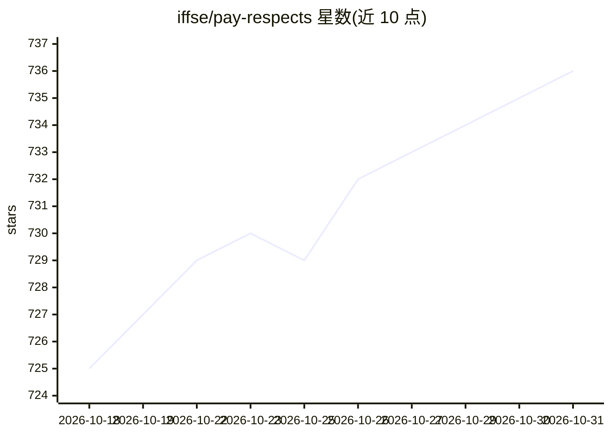

# iffse/pay-respects

⭐ 736 · Rust · AGPL-3.0 · 推送 2026-10-18 · [GitHub](https://github.com/iffse/pay-respects) · [官网](https://codeberg.org/iff/pay-respects) · 个人维护

**按 F 键修正 shell 命令错误的 CLI 工具，AI 为可选补充**

用 Rust 编写的命令建议与 command-not-found 处理工具：按 F 键对输错或未知的命令给出修正建议，规则以 TOML 编写并解析为 Rust 代码，也可用原生 Rust 或自定义语言模块扩展。支持 Bash/Zsh/Fish/Nushell/PowerShell，可与 tmux、Zellij、zoxide 等集成，提供实验性 Ctrl+X 行内修正模式。AI 模块（request-ai）为可选安装，在无规则命中时由 AI 补充建议，内置公共 API key 且可通过环境变量禁用。核心二进制小于 1MB，提供包管理器安装、预编译二进制与 Cargo 源码安装途径。

## 筛选速览

| 维度 | 判定 | 备注 |
|---|---|---|
| AI 角色 | `ai-enhanced` | 去掉 AI 部分产品仍成立 |
| 许可风险 | `viral` | AGPL-3.0 |
| 部署形态 | `library` | 以包/库形式分发 |
| 模型依赖 | — | README 未给出锁定关系 |
| 硬件要求 | — | 无带数字的原话,不猜 |
| 安装摩擦 | `medium` | 含编译或系统依赖之一 |
| 成熟度 | — | 结构信号不足 |

## 能力要点

- 按 F 键给出命令修正建议，核心二进制小于 1MB
- 规则以 TOML 编写解析为 Rust 代码，支持原生 Rust 与自定义模块
- 支持 Bash/Zsh/Fish/Nushell/PowerShell 及任意 shell 的环境变量初始化
- 可选 AI 模块在无规则时补充建议，内置公共 API key

## 适用场景

- 输错命令后按 F 快速获得修正建议
- 作为 command-not-found 处理器提示可安装的命令
- 为常用错误编写 TOML 规则定制建议

## 场景标签

 · 领域:命令行工具/开发效率

## 证据(README 行号)

> L15: - 🤖 **AI Support**: AI module comes in aid when there is no rule for your
> L227: AI suggestions should work out of the box with `request-ai` module installed.

## 星数曲线

2026-10-18 725 → 2026-10-31 736（+11）

---
*卡片 v1 · prompt 1.4 · 生成 2026-10-21 · 置信度 high · 依据 README sha `38cab0890b45` · [字段定义](../../DATASET.md)*
