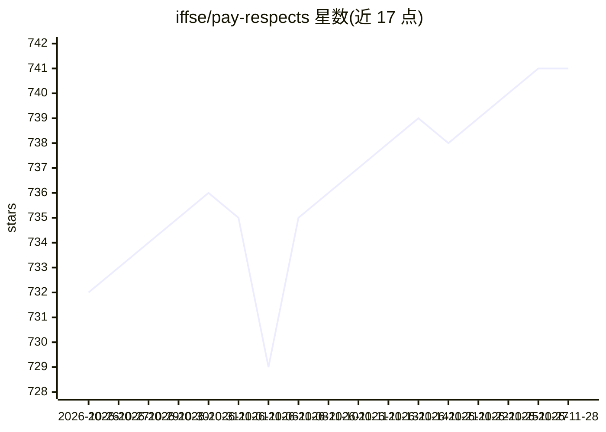

# iffse/pay-respects

⭐ 741 · Rust · AGPL-3.0 · 推送 2026-11-06 · [GitHub](https://github.com/iffse/pay-respects) · [官网](https://codeberg.org/iff/pay-respects) · 个人维护

**给命令行用户的报错命令修复建议工具（thefuck 替代品）**

Rust 编写的 shell 命令纠错工具，声称替代 thefuck：命令失败后按 F 获取修复建议并执行。核心机制是 TOML 规则文件（无需改 Rust 即可编写修复规则），建议先经检查再呈现；支持 Bash/Zsh/Fish/Dash/Xonsh/Elvish/Nushell/PowerShell，提供 command-not-found 钩子、实验性内联修复模式（Ctrl-X Ctrl-X）。AI 建议为可选 opt-in 模块（request-ai），源码内置 API key 走作者代理服务，作者声明限速时可能停止。二进制 AGPL-3.0，核心二进制小于 1 MB。

## 筛选速览

| 维度 | 判定 | 备注 |
|---|---|---|
| AI 角色 | `ai-enhanced` | 去掉 AI 部分产品仍成立 |
| 许可风险 | `viral` | AGPL-3.0 |
| 部署形态 | `library` | 以包/库形式分发 |
| 模型依赖 | — | README 未给出锁定关系 |
| 硬件要求 | — | 无带数字的原话,不猜 |
| 安装摩擦 | `medium` | 含编译或系统依赖之一 |
| 成熟度 | — | 结构信号不足 |

## 能力要点

- TOML 规则编写修复方案，支持 Rust、解释脚本与模块扩展
- 支持 8 种 shell，含 command-not-found 钩子与内联修复模式
- 可选 AI 建议模块，内置免费代理 API key（可能限速停止）
- 核心二进制小于 1 MB，基准初始化耗时亚毫秒级

## 适用场景

- 命令打错字时按一个键获得并执行修复建议
- 处理 command-not-found 提示，直接给出正确命令
- 在 Nushell/PowerShell 等多 shell 环境统一纠错体验
- 通过编写 TOML 规则定制自己的修复逻辑

## 场景标签

`AI 助手` · 领域:对话与助手

## 证据(README 行号)

> L9: - 🤖 **Optional AI**: No rule? Let AI take a shot!
> L233: - Writing rules (TOML, Rust, interpreted languages)

## 星数曲线

2026-10-26 732 → 2026-11-28 741（+9）

---
*卡片 v1 · prompt 1.4 · 生成 2026-11-24 · 置信度 high · 依据 README sha `da282cb81424` · [字段定义](../../DATASET.md)*
