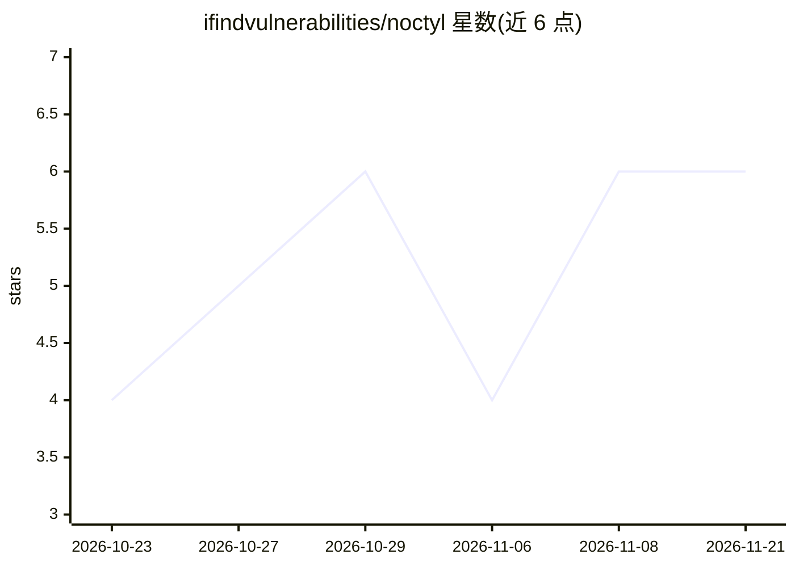

# ifindvulnerabilities/noctyl

⭐ 6 · JavaScript · AGPL-3.0 · 推送 2026-10-31 · [GitHub](https://github.com/ifindvulnerabilities/noctyl) · [官网](https://cyberwatch.cc/projects/noctyl) · 个人维护

**给开发者的可定制 agent harness，统一接入本地与外部模型**

Noctyl 是一个开源、可定制的 agent harness，将本地模型与外部 provider 统一到一个平台使用。提供桌面应用（Electron 类编译或 npm 直接启动）与 web 服务器两种运行形态，服务器支持单用户/开放注册/管理员开户三种模式、config.json 配置、环境变量、终端账号管理，并可指定 Ollama 地址。要求 Node.js 22.13 以上，服务器部分无 npm 依赖。README 未给出 agent 能力本身的详细功能清单，主要集中在安装、启动与服务器配置。

## 筛选速览

| 维度 | 判定 | 备注 |
|---|---|---|
| AI 角色 | `ai-ecosystem` | LLM/agent 周边工具 |
| 许可风险 | `viral` | AGPL-3.0 |
| 部署形态 | `library` | 以包/库形式分发 |
| 模型依赖 | local-ok | 支持本地模型 |
| 硬件要求 | — | 无带数字的原话,不猜 |
| 安装摩擦 | `low` | 无编译、无系统依赖或容器化 |
| 成熟度 | — | 结构信号不足 |

## 能力要点

- 桌面应用与 web 服务器两种运行形态，服务器可部署在 VPS
- 支持单用户/开放注册/管理员三种账号模式与会话时长、空闲登出配置
- 通过 --ollama 选项或环境变量指定本地或远程 Ollama 地址
- 提供终端命令管理账号、模式与数据目录

## 适用场景

- 在本地私有部署运行 agent 并接入自有模型服务
- 在 VPS 或 tailnet 内部署多人使用的 agent web 服务
- 按不同注册模式管理团队或个人的账号访问

## 场景标签

`模型网关` `Agent 框架` · 领域:Agent 开发

## 证据(README 行号)

> L4: The ultimate privacy-focused agent harness that allows you to bring all your local and external providers to one uni
> L49: node server/index.js --data <folder> --port <port> --host <address> --mode <mode> --ollama <address>
> L85: |`--mode`|Who can sign in?|`single` (just you), `open` (anyone can sign up), `admin` (only admins add accounts)|

## 星数曲线

2026-10-23 4 → 2026-11-21 6（+2）

---
*卡片 v1 · prompt 1.4 · 生成 2026-11-20 · 置信度 mid · 依据 README sha `c779bff5a701` · [字段定义](../../DATASET.md)*
