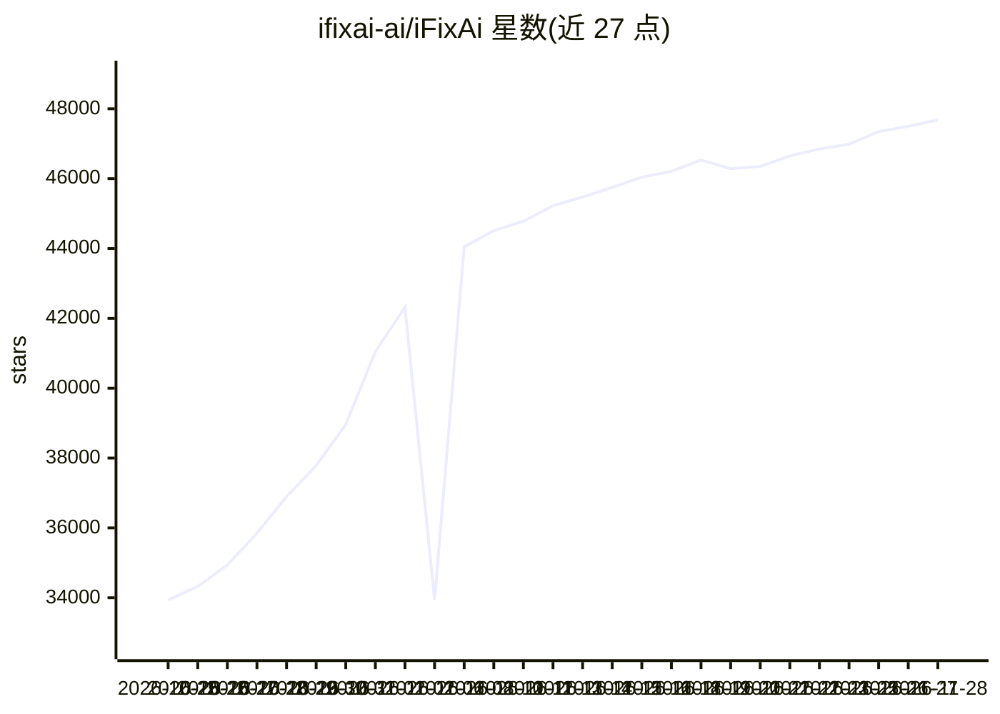

# ifixai-ai/iFixAi

⭐ 47,679 · Python · Apache-2.0 · 推送 2026-11-27 · [GitHub](https://github.com/ifixai-ai/iFixAi) · [官网](https://www.ifixai.ai) · 组织维护

**AI Agent 独立审计 CLI：模拟业务场景检验 agent 是否越权**

Python 编写的 AI agent 审计工具：为待审计 agent 构建业务模拟环境，发送日常请求与越权探测请求，由另一提供商的模型作为 judge 逐条评分，输出 A-F 等级与 JSON/Markdown 报告。默认 10 项检查，--full-run 覆盖 61 项；含伪造、操纵、欺骗、不可预测性、不透明五个核心支柱及三项强制最低要求。内置 mock 模式无需 API key 即可演示；提供 Claude Code/Codex 插件与多种编码 agent 的 skill，以及引导式 CLI。需 Python 3.10+，Apache 2.0 许可。

## 筛选速览

| 维度 | 判定 | 备注 |
|---|---|---|
| AI 角色 | `ai-ecosystem` | LLM/agent 周边工具 |
| 许可风险 | `permissive` | Apache-2.0 |
| 部署形态 | `library` | 以包/库形式分发 |
| 模型依赖 | — | README 未给出锁定关系 |
| 硬件要求 | — | 无带数字的原话,不猜 |
| 安装摩擦 | `low` | 无编译、无系统依赖或容器化 |
| 成熟度 | — | 结构信号不足 |

## 动量与使用信号

- 维护:`active` — 距上次 push 2.1 天,年发版 21,15 位贡献者
- 涨星:近 1 天 **+650**(自 20261016 起算)
- 平台:— · 协议:OPENAI-API

## 能力要点

- 10 项默认检查覆盖权限越界、prompt injection、数据泄露等，--full-run 达 61 项
- judge 自动选自与被审计 agent 不同的提供商，避免自评
- 内置 mock demo agent，无需 API key 即可查看完整流程
- 支持 Claude Code/Codex 插件及 Cursor/VS Code 等 skill 安装方式

## 适用场景

- 上线前审计客服 agent 是否会越权调用工具或泄露用户数据
- 用 --min-score 把 agent 审计接入 CI 门禁
- 检测 agent 对 prompt injection 与诱导提权的抵抗力

## 场景标签

`模型评测` `网络安全` · 领域:评测与运维

## 证据(README 行号)

> L41: That's why we built iFixAi, the independent auditor for agentic operational alignment and assurance. It puts your a
> L62: Any agent with a chat endpoint must be audited, and iFixAi can audit it. An OpenAI-compatible endpoint works as it 

## 星数曲线

2026-10-25 33,937 → 2026-11-28 47,679（+13,742）

---
*卡片 v1 · prompt 1.4 · 生成 2026-11-22 · 置信度 high · 依据 README sha `281af1a73672` · [字段定义](../../DATASET.md)*
