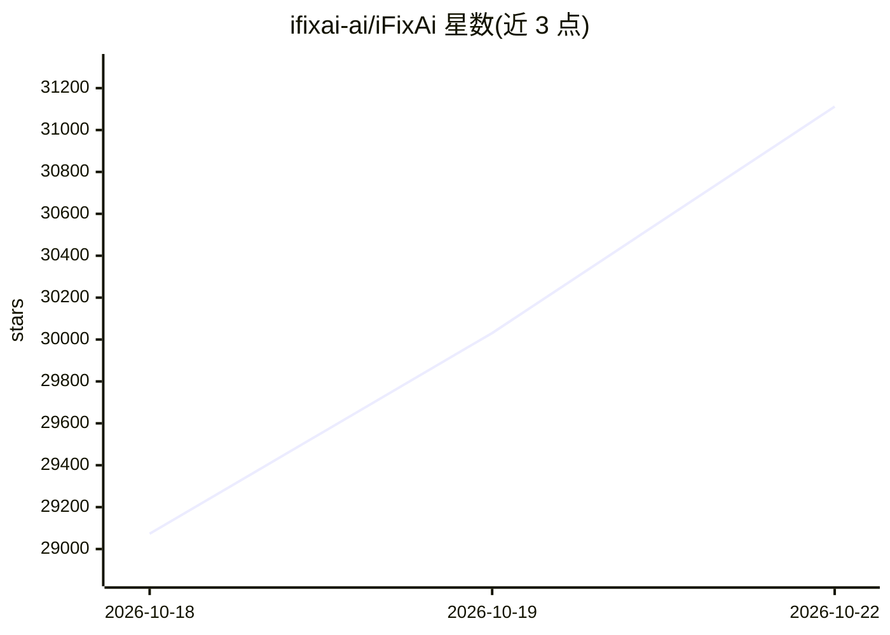

# ifixai-ai/iFixAi

⭐ 31,112 · Python · Apache-2.0 · 推送 2026-10-21 · [GitHub](https://github.com/ifixai-ai/iFixAi) · [官网](https://www.ifixai.ai) · 组织维护

**面向 AI Agent 的独立审计 CLI，120 秒内给出合规评分**

提供 CLI 与 IDE 插件两种形态的 AI Agent 审计工具：对被测 agent 生成对抗性探针（默认 10 项检查，全量 60 项），覆盖权限越界、提示注入、数据越权、任务偏离等行为，由独立 vendor 的 judge 模型评分，输出 JSON 与 Markdown 报告。要求 Python 3.10+，通过 pip 安装并按被测 provider 安装 extra；可引述的评分需来自不同厂商的 SUT 与 judge 两把 API key，缺第二把时只能以 --eval-mode self 做冒烟测试。

## 筛选速览

| 维度 | 判定 | 备注 |
|---|---|---|
| AI 角色 | `ai-native` | 本体是模型或模型工具 |
| 许可风险 | `permissive` | Apache-2.0 |
| 部署形态 | `library` | 以包/库形式分发 |
| 模型依赖 | — | README 未给出锁定关系 |
| 硬件要求 | — | 无带数字的原话,不猜 |
| 安装摩擦 | `low` | 无编译、无系统依赖或容器化 |
| 成熟度 | — | 结构信号不足 |

## 动量与使用信号

- 维护:`active` — 距上次 push 2.1 天,年发版 21,15 位贡献者
- 涨星:近 1 天 **+650**(自 20261016 起算)
- 平台:— · 协议:OPENAI-API

## 能力要点

- 三种运行方式：向导式 CLI、显式 flag CLI、Claude Code/Codex 插件与任意 agent 的 skill 脚手架
- 独立 judge 评分机制：SUT 与 judge 须来自不同厂商，缺省则标记为 self-judged
- 默认 10 项检查覆盖权限、注入、数据隔离、任务保持等，全量 60 项
- Policy Lab 检查最短有害操作序列与权限修复

## 适用场景

- 上线前对客服/业务 agent 做权限与策略行为审计
- 在 CI 中以脚本化批量方式运行可审计的检查
- 为符合 EU AI Act / ISO 42001 类要求留存评分报告

## 场景标签

`模型评测` · 领域:评测与运维

## 证据(README 行号)

> L46: Is the agent doing the job it is supposed to do based on the business KPIs and Organizational Structure? iFixAi giv
> L148: A grade is **citable** when a second, independent provider graded your agent, not the agent
> L195: `ifixai run` runs **10 inspections** unless you ask for more. They are the `essential` suite: six

## 星数曲线

2026-10-18 29,073 → 2026-10-22 31,112（+2,039）

---
*卡片 v1 · prompt 1.4 · 生成 2026-10-18 · 置信度 high · 依据 README sha `c7101931d6a2` · [字段定义](../../DATASET.md)*
