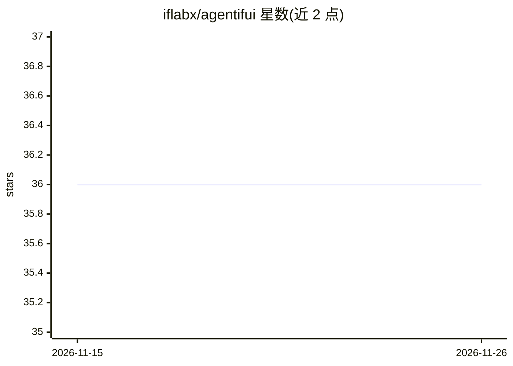

# iflabx/agentifui

⭐ 36 · TypeScript · Apache-2.0 · 推送 2026-11-23 · [GitHub](https://github.com/iflabx/agentifui) · [官网](https://www.agentifui.com) · 组织维护

**面向企业的 Agent 前端 UI：接入已有 Dify 与兼容 LangChain 服务**

企业级 Agent UI 前端，为已部署的 Dify 应用和兼容 LangChain 的 Agent 服务提供聊天、chatflow、workflow 等多应用界面与共享 AG-UI 交互层，本身不构建或托管 Agent。技术栈为 Next.js 16 + React 19 + Fastify sidecar + PostgreSQL/Redis/MinIO，含 better-auth 登录/SSO、RLS 感知持久化、错误事件捕获。以 Docker Compose 或 host/PM2 自托管部署。社区版 Apache 2.0，另提供商业许可联系方式。

## 筛选速览

| 维度 | 判定 | 备注 |
|---|---|---|
| AI 角色 | `ai-ecosystem` | LLM/agent 周边工具 |
| 许可风险 | `permissive` | Apache-2.0 |
| 部署形态 | `self-host` | docker 或自建部署 |
| 模型依赖 | — | README 未给出锁定关系 |
| 硬件要求 | — | 无带数字的原话,不猜 |
| 安装摩擦 | `low` | 无编译、无系统依赖或容器化 |
| 成熟度 | — | 结构信号不足 |

## 能力要点

- Dify 与兼容 LangChain 后端多应用 UI，共享聊天/历史
- better-auth 登录、SSO、本地密码与手机 OTP
- Fastify sidecar 承载部分 API 与代理路由
- PostgreSQL RLS 感知持久化与 Redis 实时/缓存

## 适用场景

- 为企业内已有的 Dify/LangChain Agent 提供统一访问界面
- 自托管部署带认证与权限隔离的 Agent 门户
- 通过 AG-UI 共享交互层统一不同后端的会话体验

## 场景标签

`聊天机器人` · 领域:对话与助手

## 证据(README 行号)

> L6: AgentifUI is an enterprise-oriented Agent UI for existing Dify applications and compatible LangChain Agent services,
> L15: - Dify and compatible LangChain backends, with shared chat/history and explicitly bounded AG-UI support

## 星数曲线

2026-11-15 36 → 2026-11-26 36（+0）

---
*卡片 v1 · prompt 1.4 · 生成 2026-11-18 · 置信度 high · 依据 README sha `4729195bcfd0` · [字段定义](../../DATASET.md)*
