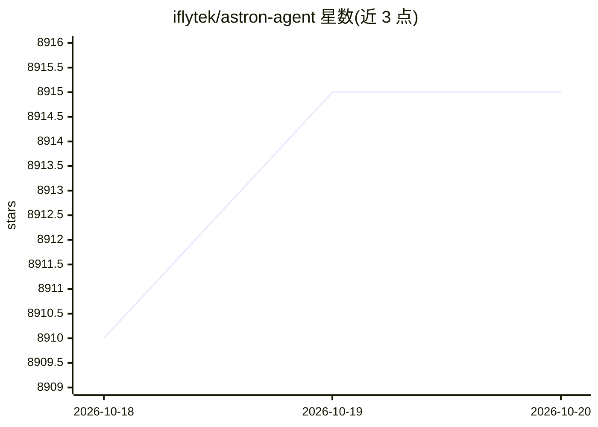

# iflytek/astron-agent

⭐ 8,915 · Java · Apache-2.0 · 推送 2026-10-14 · [GitHub](https://github.com/iflytek/astron-agent) · [官网](http://astron.ai/) · 组织维护 · 中文 README

**企业级 Agentic 工作流开发平台：编排、模型管理与 RPA 集成**

由科大讯飞开源的企业级 Agentic Workflow 开发平台，整合 AI 工作流编排、模型管理、AI 与 MCP 工具集成、RPA 自动化与团队协作功能；支持高可用部署，可一键部署或经 HTTP/SSE 调用已发布工作流。模型接入方式包括快速 API 接入与企业级 MaaS 本地集群部署。采用 Apache 2.0 许可，商业使用无限制。提供 Docker Compose 部署，Helm 部署开发中；另有云端版 Astron Cloud。

## 筛选速览

| 维度 | 判定 | 备注 |
|---|---|---|
| AI 角色 | `ai-ecosystem` | LLM/agent 周边工具 |
| 许可风险 | `permissive` | Apache-2.0 |
| 部署形态 | `self-host` | docker 或自建部署 |
| 模型依赖 | — | README 未给出锁定关系 |
| 硬件要求 | — | 无带数字的原话,不猜 |
| 安装摩擦 | `low` | 无编译、无系统依赖或容器化 |
| 成熟度 | — | 结构信号不足 |

## 能力要点

- AI 工作流编排与模型管理一体化
- 原生集成智能 RPA，实现跨系统流程自动化
- 支持 API 接入模型与一键部署企业级 MaaS 本地集群
- 通过 HTTP/SSE 从现有项目调用已发布工作流

## 适用场景

- 企业搭建可高可用部署的智能体应用
- 将 Agent 与内部系统流程通过 RPA 打通
- 在 Kubernetes 环境部署 Agentic 工作流平台

## 场景标签

`工作流自动化` `多智能体` `Agent 框架` · 领域:Agent 开发

## 证据(README 行号)

> L14: Astron Agent is an **enterprise-grade, commercial-friendly** Agentic Workflow development platform that integrates 
> L27: - **Flexible Large Model Support:** Offers diverse access methods, from rapid API-based model access and validation

## 星数曲线

2026-10-18 8,910 → 2026-10-20 8,915（+5）

---
*卡片 v1 · prompt 1.4 · 生成 2026-10-20 · 置信度 high · 依据 README sha `8b0ec49914f1` · [字段定义](../../DATASET.md)*
