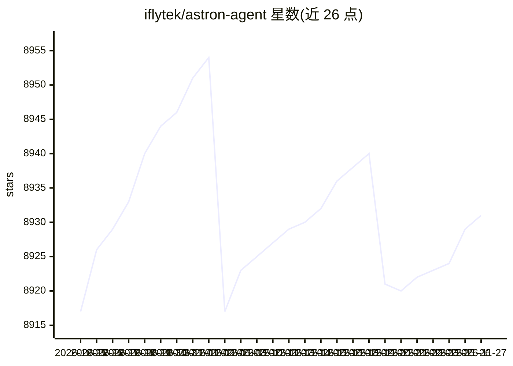

# iflytek/astron-agent

⭐ 8,931 · Python · Apache-2.0 · 推送 2026-11-26 · [GitHub](https://github.com/iflytek/astron-agent) · [官网](http://astron.ai/) · 组织维护 · 中文 README

**企业级 Agentic 工作流开发平台：编排智能体应用与模型接入**

iflytek 开源的企业级 Agentic Workflow 开发平台，功能覆盖 AI 工作流编排、模型管理、AI 与 MCP 工具集成、RPA 自动化和团队协作。面向需要在企业内构建可扩展智能体应用的组织，支持高可用部署，模型接入支持 API 快速接入与企业本地 MaaS 集群部署。采用 Apache 2.0 许可，无商用限制。部署提供 Docker Compose 快速启动与 Helm 图表（开发中），另提供托管环境 Astron Cloud。配套生态包含 SkillHub 技能注册表与 AstronRPA。

## 筛选速览

| 维度 | 判定 | 备注 |
|---|---|---|
| AI 角色 | `ai-ecosystem` | LLM/agent 周边工具 |
| 许可风险 | `permissive` | Apache-2.0 |
| 部署形态 | `self-host` | docker 或自建部署 |
| 模型依赖 | — | README 未给出锁定关系 |
| 硬件要求 | — | 无带数字的原话,不猜 |
| 安装摩擦 | `low` | 无编译、无系统依赖或容器化 |
| 成熟度 | — | 结构信号不足 |

## 能力要点

- 整合工作流编排、模型管理、AI/MCP 工具集成与 RPA 自动化
- 支持 Docker Compose 一键部署与 Kubernetes Helm 部署路径
- 已发布工作流可通过 HTTP/SSE 从现有项目调用
- 配套 SkillHub 技能注册表与 AstronRPA 套件

## 适用场景

- 为企业内部系统构建生产级智能体应用
- 通过 RPA 集成实现跨系统流程自动化
- 低代码编排多模型与多工具的 AI 工作流
- 自托管 MaaS 集群统一管理企业模型接入

## 场景标签

`工作流自动化` `Agent 框架` · 领域:Agent 开发

## 证据(README 行号)

> L14: Astron Agent is an **enterprise-grade, commercial-friendly** Agentic Workflow development platform that integrates 
> L24: - **Enterprise-Grade High Availability:** Full-stack capabilities for development, building, optimization, and mana
> L27: - **Flexible Large Model Support:** Offers diverse access methods, from rapid API-based model access and validation

## 星数曲线

2026-10-25 8,917 → 2026-11-27 8,931（+14）

---
*卡片 v1 · prompt 1.4 · 生成 2026-11-26 · 置信度 high · 依据 README sha `2af3487ed0f9` · [字段定义](../../DATASET.md)*
