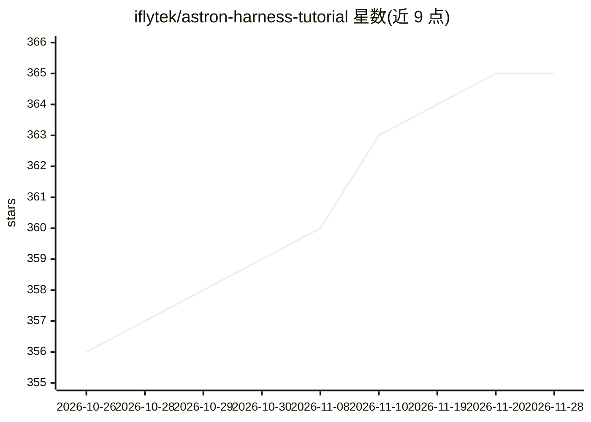

# iflytek/astron-harness-tutorial

⭐ 365 · JavaScript · Apache-2.0 · 推送 2026-11-25 · [GitHub](https://github.com/iflytek/astron-harness-tutorial) · [官网](https://astronclaw-tutorial.space/) · 组织维护 · 中文 README

**科大讯飞 AStudio/Loomy/AstronClaw 三款 AI 产品的双语教程站**

为讯飞 Astron 系列三款 AI 助手产品（AStudio 工作台、Loomy 桌面搭子、AstronClaw 云端助手）提供图文教程：按产品分章节讲解工作模式、项目与目标规划、权限、自动化、插件、本地文件连接、技能接入与消息渠道等，配官方截图与中英文对照页面。每日巡检官方资料以同步文档与配图。基于 VitePress 构建，可本地预览，并内置使用 Spark-X2.6-4B 模型的学习助手。

## 筛选速览

| 维度 | 判定 | 备注 |
|---|---|---|
| AI 角色 | `ai-knowledge` | 知识聚合/清单类 |
| 许可风险 | `permissive` | Apache-2.0 |
| 部署形态 | `None` |  |
| 模型依赖 | — | README 未给出锁定关系 |
| 硬件要求 | — | 无带数字的原话,不猜 |
| 安装摩擦 | `low` | 无编译、无系统依赖或容器化 |
| 成熟度 | — | 结构信号不足 |

## 能力要点

- 覆盖 AStudio、Loomy、AstronClaw 三款产品的入门到进阶指南
- 保存本地的官方截图，中英文页面按步骤对照操作
- 每日巡检官方资料并报告新增与替换的图片
- 内置学习助手，使用 Spark-X2.6-4B 模型流式回答

## 适用场景

- 开始使用 AStudio 完成第一个任务并学习项目与自动化
- 把 Loomy 接入本地文件与办公工具构建个人搭子
- 为 AstronClaw 托管助手接入技能与消息渠道
- 本地预览并贡献改进教程内容

## 场景标签

`教程课程` · 领域:学习与行业

## 证据(README 行号)

> L3: # Astron Harness Tutorial
> L5: **AStudio → Loomy → AstronClaw。** 从完成一个任务开始，学习如何交付真实成果，再建立适合自己的 AI 工作流。
> L40: 每日巡检按 AStudio、Loomy、AstronClaw 检查官方资料。AStudio 覆盖全部 15 个指南与协议页面，并检查图片内容；新增图片和同地址替换图片都会报告，供人工核对。详见巡检说明与图片来源清单。

## 星数曲线

2026-10-26 356 → 2026-11-28 365（+9）

---
*卡片 v1 · prompt 1.4 · 生成 2026-11-26 · 置信度 high · 依据 README sha `f07aa6ccada5` · [字段定义](../../DATASET.md)*
