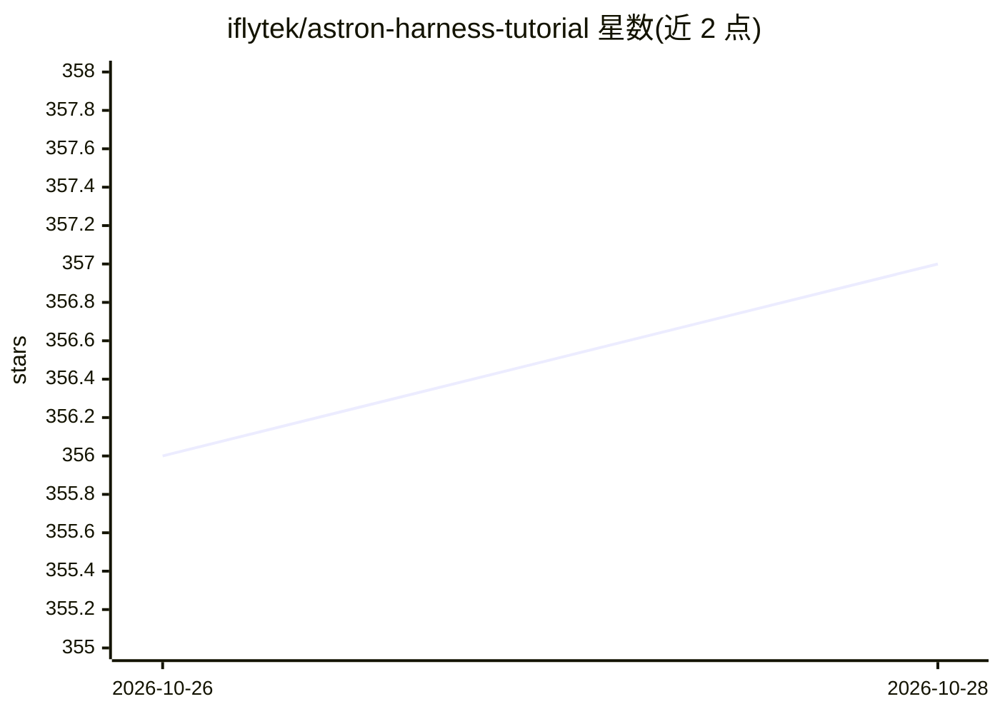

# iflytek/astron-harness-tutorial

⭐ 357 · JavaScript · Apache-2.0 · 推送 2026-10-27 · [GitHub](https://github.com/iflytek/astron-harness-tutorial) · [官网](https://astronclaw-tutorial.space/) · 组织维护 · 中文 README

**AstronClaw/Loomy/AStudio 三款 AI 助理的使用教程站**

由 iflytek 维护的 VitePress 双语文档教程，面向 AstronClaw（云端 AI 助手）、Loomy（桌面端 AI 工作助手）和 AStudio（AI 生产力工作台）三款产品：覆盖快速部署、130+ 技能系统、飞书/钉钉/企业微信渠道接入、本地文件授权、任务模式与套餐说明等，并对 15 个官方页面做每日文档巡检。本地预览需 git clone 后 npm 构建；内嵌学习助手使用 Spark-X2.6-4B 模型，需配置 MaaS API key。

## 筛选速览

| 维度 | 判定 | 备注 |
|---|---|---|
| AI 角色 | `ai-knowledge` | 知识聚合/清单类 |
| 许可风险 | `permissive` | Apache-2.0 |
| 部署形态 | `None` |  |
| 模型依赖 | — | README 未给出锁定关系 |
| 硬件要求 | — | 无带数字的原话,不猜 |
| 安装摩擦 | `low` | 无编译、无系统依赖或容器化 |
| 成熟度 | — | 结构信号不足 |

## 能力要点

- 覆盖三款产品的部署、技能系统、渠道接入与办公场景教程
- 中英双语文档并每日巡检 15 个官方页面
- 学习助手基于 Spark-X2.6-4B，支持流式回答与回归测试

## 适用场景

- 零基础用户学习部署和使用 AstronClaw 云端助手
- 自媒体/电商从业者了解 Loomy 的办公自动化场景
- 查阅 AStudio 的任务模式、套餐与隐私协议说明

## 场景标签

`教程课程` · 领域:学习与行业

## 证据(README 行号)

> L22: 本项目是一个面向 **AstronClaw**、**Loomy** 和 **AStudio** 的完整学习教程，帮助你从零开始掌握这款强大的 AI 助理系统。
> L24: * **AstronClaw**：基于 OpenClaw 核心能力打造的**云端 AI 助手**，提供全天候在线服务，随时随地通过企业微信、钉钉、飞书等渠道为你效劳。

## 星数曲线

2026-10-26 356 → 2026-10-28 357（+1）

---
*卡片 v1 · prompt 1.4 · 生成 2026-10-27 · 置信度 high · 依据 README sha `18a1ec4b1fdf` · [字段定义](../../DATASET.md)*
