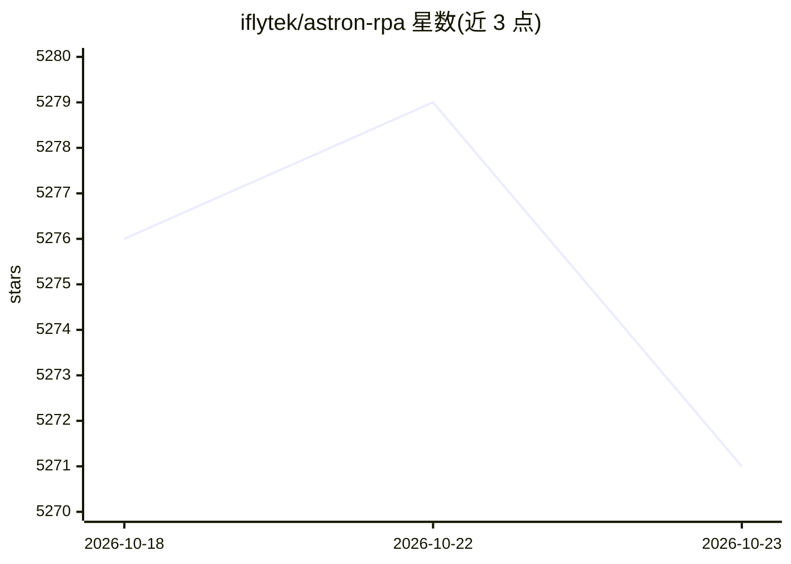

# iflytek/astron-rpa

⭐ 5,271 · Python · Apache-2.0 · 推送 2026-10-22 · [GitHub](https://github.com/iflytek/astron-rpa) · [官网](http://www.iflyrpa.com) · 组织维护 · 中文 README

**面向企业与个人的开源 RPA 桌面应用，低代码构建自动化流程**

企业级 RPA 桌面应用：通过可视化设计器支持低代码/无代码开发，自动化 Windows 桌面软件与网页，覆盖 Office/WPS、金蝶、用友及多种浏览器。提供 300+ 原子组件（UI 操作、视觉识别、Excel/PDF 处理等）与企业模块（终端监控、调度、机器人团队协作）。与 Astron Agent 平台双向集成，可在 Agent 中调用 RPA 节点；支持定时任务、API 与 MCP 触发。客户端主要支持 Windows 10/11，需 8GiB 以上内存，服务端经 Docker 部署。

## 筛选速览

| 维度 | 判定 | 备注 |
|---|---|---|
| AI 角色 | `ai-enhanced` | 去掉 AI 部分产品仍成立 |
| 许可风险 | `permissive` | Apache-2.0 |
| 部署形态 | `desktop` | 安装包/桌面程序 |
| 模型依赖 | — | README 未给出锁定关系 |
| 硬件要求 | — | 无带数字的原话,不猜 |
| 安装摩擦 | `medium` | 含编译或系统依赖之一 |
| 成熟度 | — | 结构信号不足 |

## 能力要点

- 可视化低代码设计器与 300+ 预置原子组件
- 与 Astron Agent 平台双向调用（RPA 节点↔Agent 工作流）
- 支持定时任务、API 调用与 MCP 服务等多通道触发
- 组件包覆盖系统、浏览器、GUI、视觉、Excel、PDF、加密等

## 适用场景

- 自动化办公软件与网页的重复性操作流程
- 企业内跨团队调度和监控机器人流程
- 通过 Agent 平台用智能体驱动 RPA 流程执行

## 场景标签

`工作流自动化` `GUI 自动化` `浏览器自动化` · 领域:效率与自动化

## 证据(README 行号)

> L23: AstronRPA is an enterprise-grade Robotic Process Automation (RPA) desktop application. Through a visual designer, i
> L25: Astron Agent is the native Agent platform supported by this project. Users can directly call RPA workflow nodes in 
> L33: - **🤖 Native Agent Empowerment**: Deep integration with Astron Agent platform supporting bi-directional calls betwe

## 星数曲线

2026-10-18 5,276 → 2026-10-23 5,271（-5）

---
*卡片 v1 · prompt 1.4 · 生成 2026-10-20 · 置信度 high · 依据 README sha `7da1baf33a9e` · [字段定义](../../DATASET.md)*
