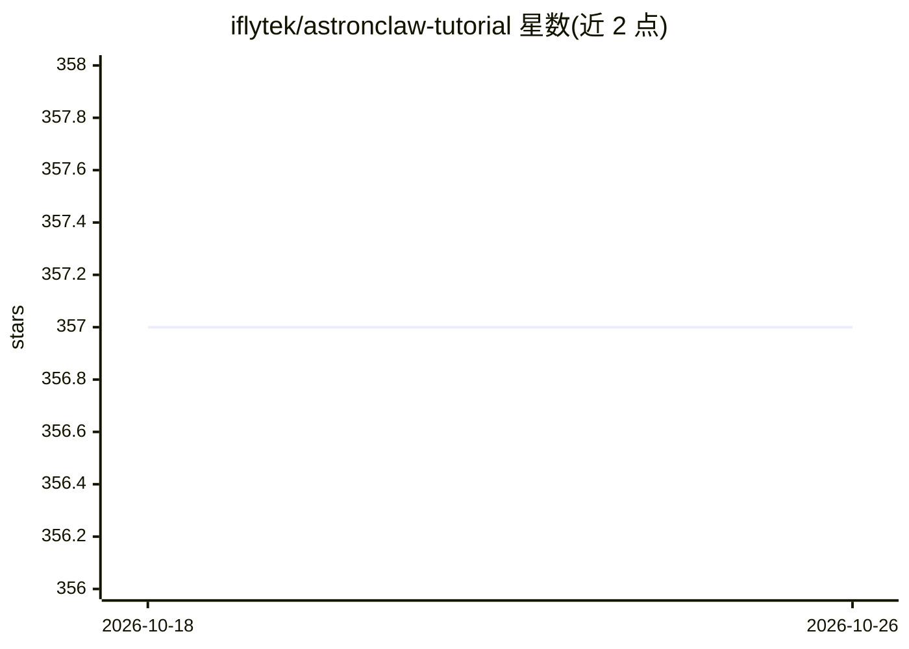

# iflytek/astronclaw-tutorial

⭐ 357 · JavaScript · Apache-2.0 · 推送 2026-10-12 · [GitHub](https://github.com/iflytek/astronclaw-tutorial) · [官网](https://astronclaw-tutorial.space/) · 组织维护 · 中文 README

**掌握 AstronClaw 云端与 Loomy 桌面 AI 助手的实战教程**

科大讯飞开源的文档教程项目，基于 VitePress 构建，面向 AstronClaw（基于 OpenClaw 核心的云端 AI 助手，接入企业微信/钉钉/飞书）与 Loomy（桌面端 AI 助手，打通本地文件与系统工具）两款产品。内容覆盖一键部署、130+ 官方技能体系、渠道接入、典型办公场景与目录级授权安全机制；受众为零基础用户、效率型用户与运营团队。本地预览需克隆仓库构建。

## 筛选速览

| 维度 | 判定 | 备注 |
|---|---|---|
| AI 角色 | `ai-knowledge` | 知识聚合/清单类 |
| 许可风险 | `permissive` | Apache-2.0 |
| 部署形态 | `None` |  |
| 模型依赖 | — | README 未给出锁定关系 |
| 硬件要求 | — | 无带数字的原话,不猜 |
| 安装摩擦 | `low` | 无编译、无系统依赖或容器化 |
| 成熟度 | — | 结构信号不足 |

## 能力要点

- 覆盖云端 AstronClaw 与桌面 Loomy 两条学习路径
- 技能系统章节覆盖技能市场、仓库搜索与自定义技能
- Loomy 支持目录级授权与自定义大模型 API 服务商

## 适用场景

- 零基础部署并使用云端 AI 助手 AstronClaw
- 用 Loomy 在桌面端搭建个人/小团队自动化工作流
- 通过飞书/钉钉/企业微信接入 AI 助手

## 场景标签

`教程课程` · 领域:学习与行业

## 证据(README 行号)

> L22: 本项目是一个面向 **AstronClaw** 和 **Loomy** 的完整学习教程，帮助你从零开始掌握这款强大的 AI 助理系统。
> L24: * **AstronClaw**：基于 OpenClaw 核心能力打造的**云端 AI 助手**，提供全天候在线服务，随时随地通过企业微信、钉钉、飞书等渠道为你效劳。
> L25: * **Loomy**：聚焦真实办公场景的**桌面端 AI 工作搭子**，深入打通本地文件和系统工具，构建个人及小团队的高效自动化工作流。

## 星数曲线

2026-10-18 357 → 2026-10-26 357（+0）

---
*卡片 v1 · prompt 1.4 · 生成 2026-10-21 · 置信度 high · 依据 README sha `897968308a22` · [字段定义](../../DATASET.md)*
