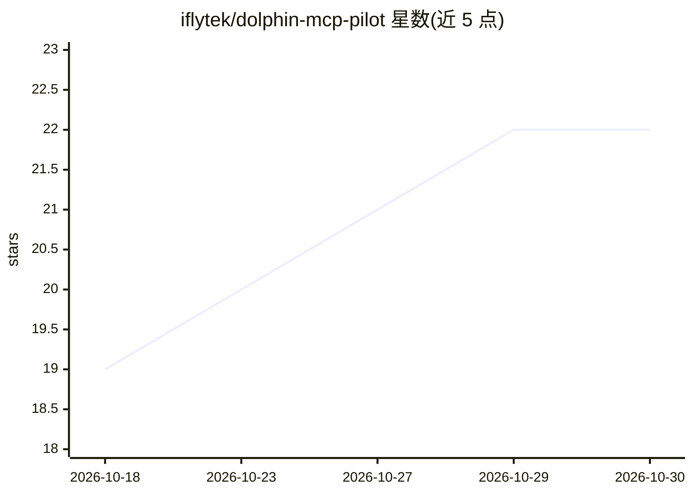

# iflytek/dolphin-mcp-pilot

⭐ 22 · Python · Apache-2.0 · 推送 2026-10-09 · [GitHub](https://github.com/iflytek/dolphin-mcp-pilot) · 组织维护 · 中文 README

**让 AI agent 操作 Apache DolphinScheduler 的 MCP 服务器**

由科大讯飞维护的 MCP server，向 AI agent 暴露 53+ 个工具，覆盖 DolphinScheduler 的项目、工作流（SQL/DAG）创建、调度管理、实例生命周期（暂停/恢复/重跑/失败重跑）、日志查看、资源管理与原始 API 透传。支持 API Token 与用户名/密码两种认证及多租户按请求认证；采用 MCP 2.0 无状态 HTTP 并兼容 1.x 客户端。面向需要真实运维（非只读）DolphinScheduler 的 agent 场景，要求先有可达的 DolphinScheduler 3.x 实例，主要通过 Docker Compose 部署。

## 筛选速览

| 维度 | 判定 | 备注 |
|---|---|---|
| AI 角色 | `ai-ecosystem` | LLM/agent 周边工具 |
| 许可风险 | `permissive` | Apache-2.0 |
| 部署形态 | `self-host` | docker 或自建部署 |
| 模型依赖 | — | README 未给出锁定关系 |
| 硬件要求 | — | 无带数字的原话,不猜 |
| 安装摩擦 | `low` | 无编译、无系统依赖或容器化 |
| 成熟度 | — | 结构信号不足 |

## 能力要点

- 53+ 工具覆盖工作流创建、调度、实例控制、日志与资源管理
- MCP 2.0 无状态 HTTP，兼容 MCP 1.x 客户端与 stdio
- API Token / 用户密码双认证，多租户按请求携带凭据
- Raw API 透传处理未覆盖的边缘操作

## 适用场景

- 让 agent 排查失败任务、查看日志并建议下一步操作
- 通过对话创建 SQL 工作流并配置 cron 调度
- 让多个 agent 各自持凭据共用同一 MCP 服务做补数/回滚

## 场景标签

`工作流自动化` · 领域:效率与自动化

## 证据(README 行号)

> L11: A production-ready MCP server for Apache DolphinScheduler (小海豚).
> L13: **dolphin-mcp-pilot** exposes **53+ tools** for projects, workflows, DAG creation, schedules, instances, resources,

## 星数曲线

2026-10-18 19 → 2026-10-30 22（+3）

---
*卡片 v1 · prompt 1.4 · 生成 2026-10-28 · 置信度 high · 依据 README sha `eb8bc6f62733` · [字段定义](../../DATASET.md)*
