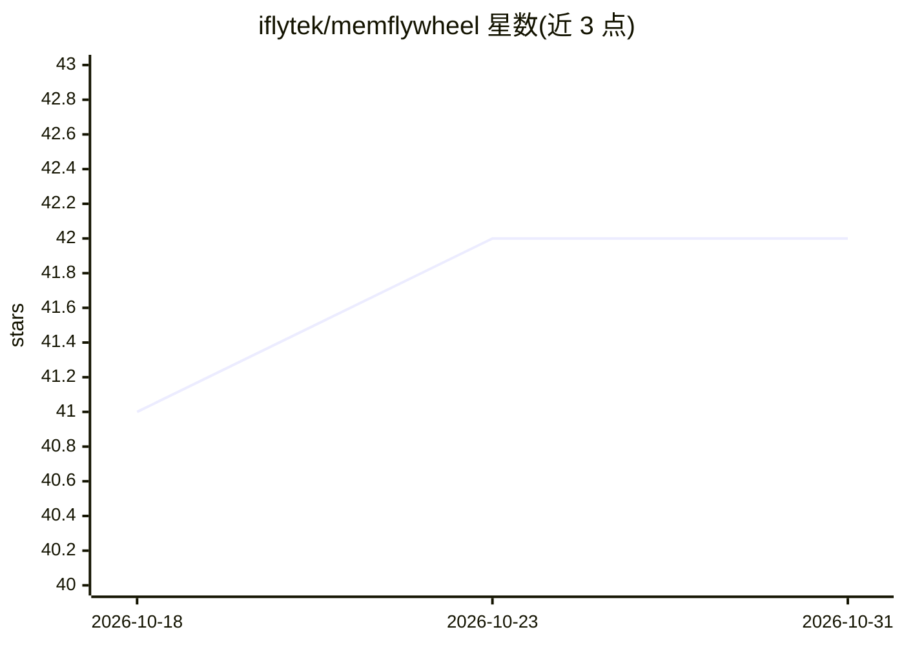

# iflytek/memflywheel

⭐ 42 · TypeScript · Apache-2.0 · 推送 2026-10-19 · [GitHub](https://github.com/iflytek/memflywheel) · [官网](https://iflytek.github.io/memflywheel/) · 组织维护 · 中文 README

**给 Agent Harness 加文件原生长期记忆与技能飞轮的插件**

以 npm 包形式为 Pi、Hermes、OpenCode、OpenClaw 等 Agent Harness 安装原生记忆插件：执行前召回（可选 OpenAI 兼容 embedding 预召回，否则注入最多 200 行 MEMORY.md 索引）、执行后提取与 dream 整理，把重复工作流演化成可复用的学习技能。记忆以 Markdown 文件存储，可检查、可 diff；宿主 Harness 继续掌管模型、工具、权限与会话，MemFlywheel 只负责记忆与学习闭环，模型无关。使用 LoCoMo 导向的回归检查度量长期记忆行为。

## 筛选速览

| 维度 | 判定 | 备注 |
|---|---|---|
| AI 角色 | `ai-ecosystem` | LLM/agent 周边工具 |
| 许可风险 | `permissive` | Apache-2.0 |
| 部署形态 | `library` | 以包/库形式分发 |
| 模型依赖 | — | README 未给出锁定关系 |
| 硬件要求 | — | 无带数字的原话,不猜 |
| 安装摩擦 | `low` | 无编译、无系统依赖或容器化 |
| 成熟度 | — | 结构信号不足 |

## 能力要点

- 支持 Pi/Hermes/OpenCode/OpenClaw 四种 Harness 的单包集成
- 文件原生 Markdown 记忆，可检查、可 diff，含来源追踪
- 执行前渐进召回 + 执行后提取与 dream 整理的记忆飞轮
- 可选 OpenAI 兼容 embedding 端点启用预召回，无 embedding 也可运行

## 适用场景

- 让我的编码 Agent 记住跨会话的项目上下文
- 把重复执行的任务固化成可复用技能
- 审计 Agent 记忆的来源与演变过程

## 场景标签

`Agent 记忆` · 领域:Agent 开发

## 证据(README 行号)

> L20: MemFlywheel adds a file-native memory flywheel to Agent Harnesses: recall before
> L28:  Harness-native Pi, Hermes, OpenCode, and OpenClaw are supported through one npm package.
> L84: MemFlywheel installs into each host as a native memory plugin. The host keeps

## 星数曲线

2026-10-18 41 → 2026-10-31 42（+1）

---
*卡片 v1 · prompt 1.4 · 生成 2026-10-25 · 置信度 high · 依据 README sha `53a3d8746b9d` · [字段定义](../../DATASET.md)*
