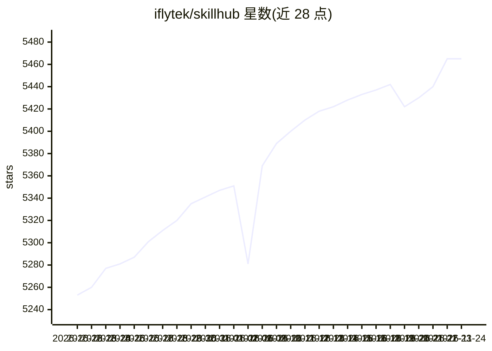

# iflytek/skillhub

⭐ 5,481 · Java · Apache-2.0 · 推送 2026-11-23 · [GitHub](https://github.com/iflytek/skillhub) · [官网](https://skill.xfyun.cn) · 组织维护 · 中文 README

**企业自托管的 agent 技能包注册中心：发布、检索与治理**

SkillHub 是一个自托管的 agent 技能包注册平台，供团队在私有环境中发布、版本化、检索和安装可复用技能包。机制包括：语义化版本与标签（beta/stable/latest）、命名空间级 RBAC（Owner/Admin/Member）、治理操作审计日志、全文检索与可见性控制、REST API 与 CLI（兼容 ClawHub 风格客户端）、可插拔存储（本地文件系统/S3/MinIO）。面向需要防火墙内部署的企业团队；默认通过 Docker 镜像脚本部署，源码开发需 Java 21 与 Node.js。

## 筛选速览

| 维度 | 判定 | 备注 |
|---|---|---|
| AI 角色 | `ai-ecosystem` | LLM/agent 周边工具 |
| 许可风险 | `permissive` | Apache-2.0 |
| 部署形态 | `self-host` | docker 或自建部署 |
| 模型依赖 | — | README 未给出锁定关系 |
| 硬件要求 | — | 无带数字的原话,不猜 |
| 安装摩擦 | `low` | 无编译、无系统依赖或容器化 |
| 成熟度 | — | 结构信号不足 |

## 能力要点

- 技能包发布与语义化版本管理，支持 beta/stable 标签与 latest 跟踪
- 命名空间级 RBAC 与审计日志治理
- 原生 REST API + CLI，并兼容 ClawHub 风格注册表客户端
- 可插拔存储：本地文件系统（开发）/ S3 与 MinIO（生产）

## 适用场景

- 企业在防火墙内搭建私有 agent 技能包仓库
- 团队按命名空间管理技能的发布权限与审核流程
- 通过 CLI 在 agent 中检索并安装内部技能包

## 场景标签

 · 领域:AI 基础设施/agent 技能注册与治理

## 证据(README 行号)

> L3:  An enterprise-grade, open-source agent skill registry — publish, discover, and manage reusable skill packages acros
> L23: SkillHub is a self-hosted platform that gives teams a private,
> L26: install it via CLI. Built for on-premise deployment behind your

## 星数曲线

2026-10-22 5,253 → 2026-11-24 5,465（+212）

---
*卡片 v1 · prompt 1.4 · 生成 2026-11-22 · 置信度 high · 依据 README sha `3dcfb7ac56bc` · [字段定义](../../DATASET.md)*
