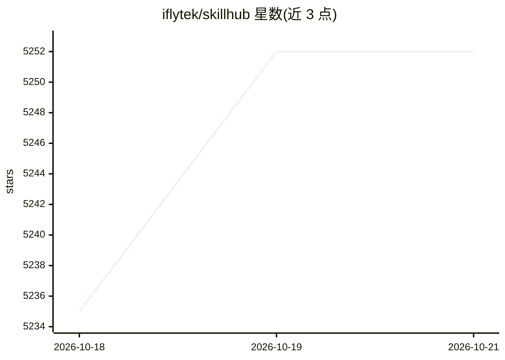

# iflytek/skillhub

⭐ 5,252 · Java · Apache-2.0 · 推送 2026-10-19 · [GitHub](https://github.com/iflytek/skillhub) · [官网](https://skill.xfyun.cn) · 组织维护 · 中文 README

**企业自托管的 agent 技能注册表：发布、检索与治理技能包**

面向企业团队的自托管 agent 技能包注册平台：以语义化版本发布技能包到团队命名空间，通过全文搜索、下载量与评分发现技能，并用 CLI 安装。治理机制包括命名空间级角色（Owner/Admin/Member）、双级审核（命名空间管理员+平台管理员）、审计日志、可见性规则与作用域 API token。支持防火墙内本地部署，通过 curl 脚本或 Docker Compose 启动，可插拔存储（本地文件/S3/MinIO），并提供 Prometheus+Grafana 监控栈；需 Docker 环境运行。

## 筛选速览

| 维度 | 判定 | 备注 |
|---|---|---|
| AI 角色 | `ai-ecosystem` | LLM/agent 周边工具 |
| 许可风险 | `permissive` | Apache-2.0 |
| 部署形态 | `self-host` | docker 或自建部署 |
| 模型依赖 | — | README 未给出锁定关系 |
| 硬件要求 | — | 无带数字的原话,不猜 |
| 安装摩擦 | `low` | 无编译、无系统依赖或容器化 |
| 成熟度 | — | 结构信号不足 |

## 能力要点

- 技能包语义化版本发布与 latest 自动追踪
- 命名空间级 RBAC、双级审核与审计日志
- 原生 REST API + CLI，兼容 ClawHub 式注册表客户端协议
- Docker/Compose 部署，镜像支持 linux/amd64、arm64、riscv64

## 适用场景

- 在企业内网私有化共享和治理 agent 技能包
- 团队按命名空间管理技能的发布、审核与权限
- 通过 CLI 在 agent 环境中安装组织内技能

## 场景标签

 · 领域:AI 基础设施/agent 技能管理

## 证据(README 行号)

> L23: SkillHub is a self-hosted platform that gives teams a private,
> L68: - **Publish & Version** — Upload agent skill packages with semantic

## 星数曲线

2026-10-18 5,235 → 2026-10-21 5,252（+17）

---
*卡片 v1 · prompt 1.4 · 生成 2026-10-20 · 置信度 high · 依据 README sha `863193973fb6` · [字段定义](../../DATASET.md)*
