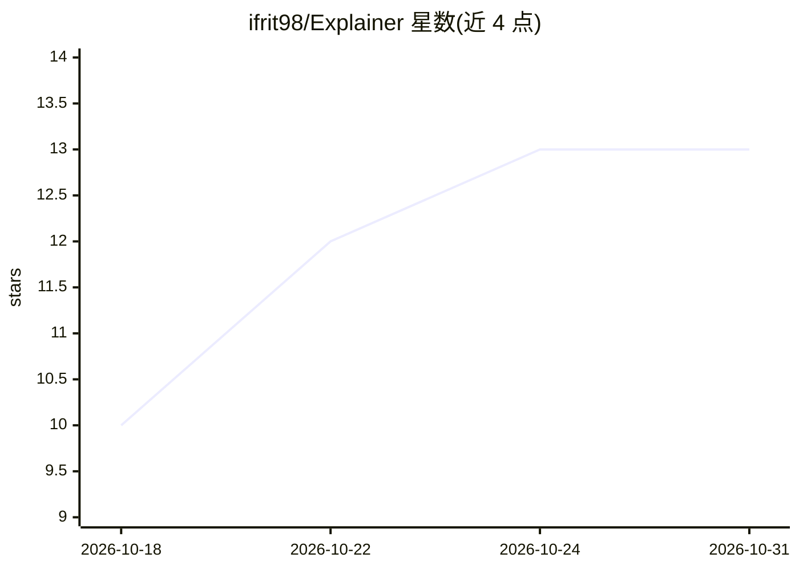

# ifrit98/Explainer

⭐ 13 · HTML · MIT · 推送 2026-10-30 · [GitHub](https://github.com/ifrit98/Explainer) · [官网](https://ifrit98.github.io/Explainer/) · 个人维护

**Claude Code 插件：把问题编译为第一性原理讲解（文本/图/交互页/视频）**

面向 Claude Code 用户的解释编译器插件：对提问构建主题模型（实体、因果链、数字、待证声明），按结构复杂度选择最低呈现层级（纯文本/图示/交互页面/带本地配音的 3Blue1Brown 式视频），再由叙事层组织读者路径。所有呈现从同一模型编译，并经 probe/coldread/check/quiz 等检查环节核查遗漏与冗余，CI 中运行。视频阶段需 Cairo、Pango、FFmpeg 与一次性本地语音设置（Kokoro 合成，无需 API key）。通过 /plugin 命令安装。

## 筛选速览

| 维度 | 判定 | 备注 |
|---|---|---|
| AI 角色 | `ai-native` | 本体是模型或模型工具 |
| 许可风险 | `permissive` | MIT |
| 部署形态 | `None` |  |
| 模型依赖 | locked-api |  |
| 硬件要求 | — | 无带数字的原话,不猜 |
| 安装摩擦 | `medium` | 含编译或系统依赖之一 |
| 成熟度 | — | 结构信号不足 |

## 能力要点

- 三遍流程：Model→Stage（4 级呈现阶梯）→Narrative，同一模型编译出多种呈现
- 检查机制：probe 查遗漏、coldread 查未引入符号与冗余、check 核数字与篇幅
- Kokoro 本地 TTS 按句合成并记录时间点，无需 API key
- 提供 explain/video/verify 技能与 STE-80 写作风格

## 适用场景

- 向 Claude Code 提问并获得从第一性原理出发的结构化讲解
- 把抽象概念（softmax、自注意力、Dijkstra）做成交互页或讲解视频
- 对已有解释做遗漏与冗余检查（verify/probe/coldread）

## 场景标签

`教程课程` · 领域:学习与行业

## 证据(README 行号)

> L9: **An explanation compiler for Claude Code.** Ask how something works, and get the explanation that costs you the lea
> L21: In Claude Code:

## 星数曲线

2026-10-18 10 → 2026-10-31 13（+3）

---
*卡片 v1 · prompt 1.4 · 生成 2026-10-31 · 置信度 high · 依据 README sha `35df16f71933` · [字段定义](../../DATASET.md)*
