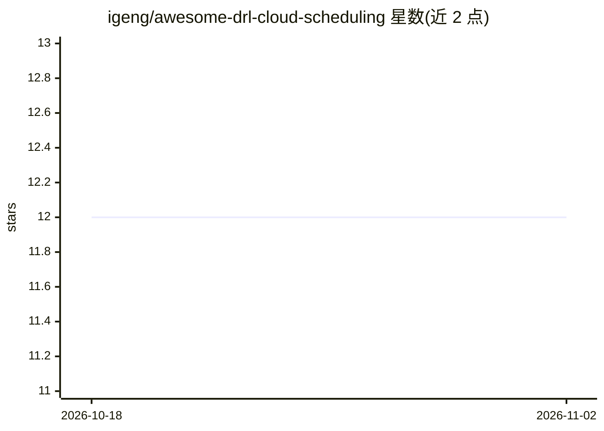

# igeng/awesome-drl-cloud-scheduling

⭐ 12 · 推送 2026-08-27 · [GitHub](https://github.com/igeng/awesome-drl-cloud-scheduling) · 个人维护

**DRL 云资源调度与弹性伸缩研究的论文与代码策展清单**

策展型 awesome 清单：收录约 219 条将深度强化学习应用于云/微服务资源调度、服务弹性伸缩、任务放置与资源分配的研究论文，条目含作者、发表 venue、摘要与代码可用性，按 DRL 调度、弹性伸缩、边缘计算、鲁棒性与安全等主题组织，另设 Beyond DRL 类别覆盖基准测试、启发式调度、ML 预测伸缩与负载分析。正文维护于 PAPER-LIST.md，配套 CODE-LIST.md 与本地 Code/ 目录收录论文相关开源代码。供云调度与 AIOps 方向研究者检索文献与代码使用。仓库采用 MIT 许可，不提供软件安装或运行方式。

## 筛选速览

| 维度 | 判定 | 备注 |
|---|---|---|
| AI 角色 | `ai-knowledge` | 知识聚合/清单类 |
| 许可风险 | `none` | — |
| 部署形态 | `None` |  |
| 模型依赖 | — | README 未给出锁定关系 |
| 硬件要求 | — | 无带数字的原话,不猜 |
| 安装摩擦 | `low` | 无编译、无系统依赖或容器化 |
| 成熟度 | — | 结构信号不足 |

## 能力要点

- 约 219 条论文条目，含作者、venue、摘要与代码可用性标注
- 按 DRL 调度/弹性伸缩/边缘计算/鲁棒性等主题分类，另含 Beyond DRL 11 个子类
- CODE-LIST.md 与本地 Code/ 目录配套收录论文开源代码
- 通过直接编辑 PAPER-LIST.md 增改条目

## 适用场景

- 查找 DRL 用于云资源调度与弹性伸缩的研究论文
- 检索与论文配套的开源代码仓库
- 调研传统调度、启发式方法与 ML 预测伸缩等相关工作

## 场景标签

`精选清单` `科研工具` · 领域:学习与行业

## 证据(README 行号)

> L5: A curated list of *Deep Reinforcement Learning (DRL)* research and related works on:
> L21: The complete paper catalog (currently ~219 entries) is maintained in **PAPER-LIST.md**:

## 星数曲线

2026-10-18 12 → 2026-11-02 12（+0）

---
*卡片 v1 · prompt 1.4 · 生成 2026-11-01 · 置信度 high · 依据 README sha `9c32069d478b` · [字段定义](../../DATASET.md)*
