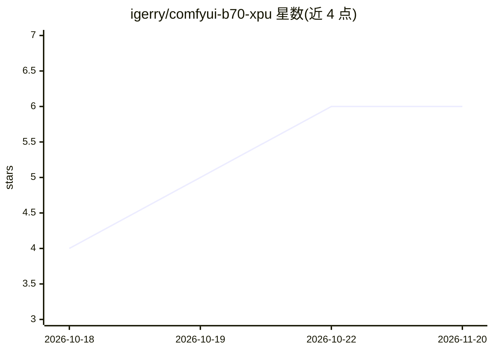

# igerry/comfyui-b70-xpu

⭐ 6 · Python · Apache-2.0 · 推送 2026-10-10 · [GitHub](https://github.com/igerry/comfyui-b70-xpu) · [官网](https://hub.docker.com/r/gerrywang/comfyui-b70-xpu) · 个人维护 · 中文 README

**在 Intel Arc Pro B70 上运行上游 ComfyUI 的调优 Docker 镜像**

基于 Intel 官方 `intel/llm-scaler-omni` 镜像构建的 ComfyUI 运行环境：将 XPU 加速栈迁移到上游 ComfyUI master 与 torch 2.13，并为 XPU 启用锁定主机内存、提供 SYCL/ESIMD INT8 内核路径。以 10.8 GB Docker 镜像形式分发，挂载点与运行命令沿用 Intel 官方镜像；也提供源码构建脚本。仅在一块 Arc Pro B70（32 GB）上以四个模型完成测试，其他 B 系列卡与其余模型未经验证。

## 筛选速览

| 维度 | 判定 | 备注 |
|---|---|---|
| AI 角色 | `ai-ecosystem` | LLM/agent 周边工具 |
| 许可风险 | `permissive` | Apache-2.0 |
| 部署形态 | `self-host` | docker 或自建部署 |
| 模型依赖 | — | README 未给出锁定关系 |
| 硬件要求 | — | 无带数字的原话,不猜 |
| 安装摩擦 | `low` | 无编译、无系统依赖或容器化 |
| 成熟度 | — | 结构信号不足 |

## 能力要点

- 基于 intel/llm-scaler-omni 的 10.8 GB Docker 镜像，挂载点与运行命令与 Intel 镜像一致
- 为 XPU 启用 pinned host memory（ComfyUI 原生仅对 NVIDIA/AMD 启用）
- 提供 SYCL/ESIMD/CUTLASS-SYCL 内核与 oneDNN INT8 GEMM 快速路径
- 附带 validate_comfyui_image.sh 校验内核是否实际加载

## 适用场景

- 在 Intel Arc Pro B70 上运行上游最新版 ComfyUI 生成图像/视频/音频
- 复现与验证 Intel 镜像之外的模型支持（如 Qwen-Image 2.1）
- 需要确定性输出（同 seed 同结果）的 ComfyUI 工作流
- 在 LXC 容器中部署 ComfyUI 的 Intel GPU 环境

## 场景标签

`图像生成` · 领域:内容生成

## 证据(README 行号)

> L20: broke, and adds kernels and fixes of its own. It ships as a **10.8 GB Docker image** built from
> L55: **Requirements:** Linux, an Intel Arc B-series GPU with working drivers, Docker.
> L108: ## Supported models

## 星数曲线

2026-10-18 4 → 2026-11-20 6（+2）

---
*卡片 v1 · prompt 1.4 · 生成 2026-11-20 · 置信度 mid · 依据 README sha `e793b1eef076` · [字段定义](../../DATASET.md)*
