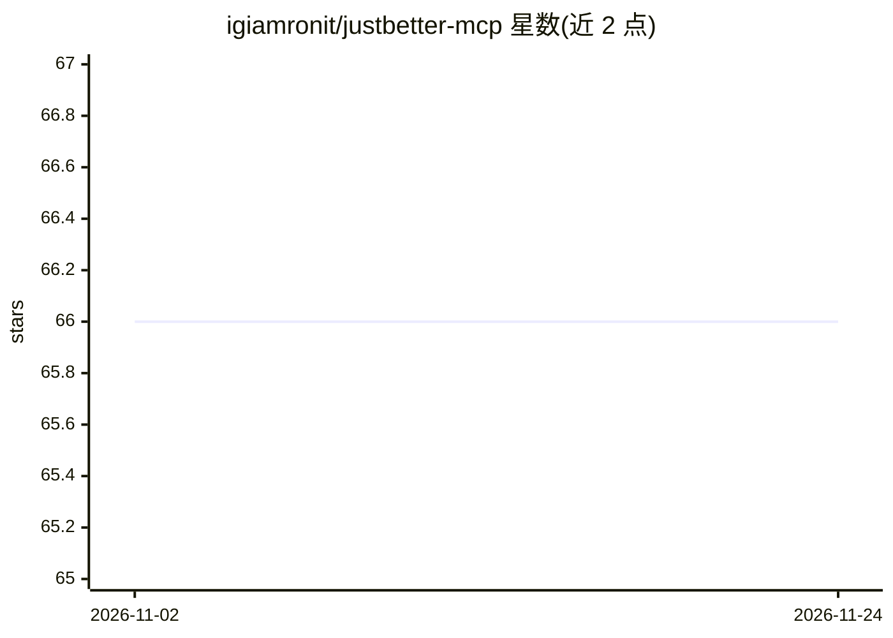

# igiamronit/justbetter-mcp

⭐ 66 · TypeScript · MIT · 推送 2026-09-27 · [GitHub](https://github.com/igiamronit/justbetter-mcp) · 个人维护

**给 LLM 开发者：MCP 网关按需注入工具，削减上下文 token**

TypeScript 编写的 MCP 网关/代理，位于 MCP 客户端与上游 MCP 服务器之间，解决全量工具注入导致的 token 膨胀问题。提供两种模式：Mode 1 拦截 HTTP 聊天请求，在首次 LLM 调用前对 prompt 做语义检索并注入所需工具 schema（需 OpenAI 兼容 base URL 的客户端）；Mode 2 仅广播 request_tools/batch_call，模型会话中按需请求工具（Claude Desktop、Cursor 可用）。工具保留采用有界工作集与单调序列号排序。安全机制含幻觉门（禁止调用未注入工具）、前置条件门与基于 SHA-256 的 schema 隔离。状态存于 ~/.justbetter-mcp。基准为 8 任务 32 次运行、单一模型，作者标注应视为方向性结果；终端命令默认无确认对话框且不受目录限制。

## 筛选速览

| 维度 | 判定 | 备注 |
|---|---|---|
| AI 角色 | `ai-ecosystem` | LLM/agent 周边工具 |
| 许可风险 | `permissive` | MIT |
| 部署形态 | `library` | 以包/库形式分发 |
| 模型依赖 | — | README 未给出锁定关系 |
| 硬件要求 | — | 无带数字的原话,不猜 |
| 安装摩擦 | `low` | 无编译、无系统依赖或容器化 |
| 成熟度 | — | 结构信号不足 |

## 能力要点

- Mode 1 在首次 LLM 调用前对 prompt 做语义检索并注入所需工具 schema
- Mode 2 按需工具发现，广播集上限 24 个、最旧优先淘汰
- 幻觉门/前置条件门/SHA-256 schema 隔离的安全管道
- 首次运行设置向导，npx 一条命令启动

## 适用场景

- 连接大量 MCP 服务器的 agent 侵蚀上下文窗口时做代理收敛
- 在 Claude Desktop/Cursor 等客户端中按需检索工具而非全量注入
- 控制 agent 的可读写目录与破坏性工具确认

## 场景标签

`模型网关` · 领域:Agent 开发

## 证据(README 行号)

> L20: > JustBetter MCP solves this by acting as a gateway/proxy. Instead of dumping every connected server's tools into e
> L22: > It operates in two main modes: **Mode 2** is essentially equivalent to Anthropic's MCP Tool Search or OpenAI Code

## 星数曲线

2026-11-02 66 → 2026-11-24 66（+0）

---
*卡片 v1 · prompt 1.4 · 生成 2026-11-18 · 置信度 high · 依据 README sha `6391bdc99ef7` · [字段定义](../../DATASET.md)*
