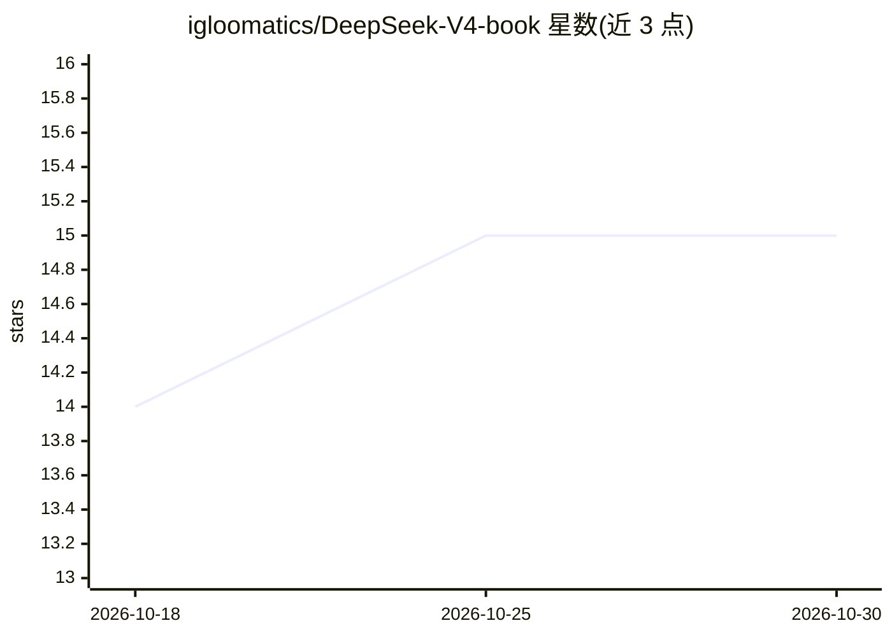

# igloomatics/DeepSeek-V4-book

⭐ 15 · HTML · MIT · 推送 2026-07-24 · [GitHub](https://github.com/igloomatics/DeepSeek-V4-book) · [官网](https://igloomatics.github.io/DeepSeek-V4-book/) · 个人维护 · 中文 README

**DeepSeek-V4 技术报告的中文交互式网页拆解书（20 章+2 附录）**

把 56 页 DeepSeek-V4 技术报告拆解为 20 章 + 2 附录的可交互中文网页书。每章先讲前代方案不足，再讲新方案动机、公式、超参与硬件取舍；公式配白话翻译，含数值演练与可拖动参数的 SVG/Canvas 交互演示，论文原图按 §+Figure+页码引用可核对原文。面向注意力研究、训练系统、后训练等不同读者提供推荐阅读路线。本地打开 index.html 即可阅读，无需构建，KaTeX/Mermaid 经 CDN 渲染。原报告版权归 DeepSeek-AI，本书内容为 MIT License。

## 筛选速览

| 维度 | 判定 | 备注 |
|---|---|---|
| AI 角色 | `ai-knowledge` | 知识聚合/清单类 |
| 许可风险 | `permissive` | MIT |
| 部署形态 | `None` |  |
| 模型依赖 | — | README 未给出锁定关系 |
| 硬件要求 | — | 无带数字的原话,不猜 |
| 安装摩擦 | `low` | 无编译、无系统依赖或容器化 |
| 成熟度 | — | 结构信号不足 |

## 能力要点

- 56 页报告拆为 20 章 + 2 附录，覆盖架构/基础设施/预训练/后训练
- 每章配公式白话翻译、数值演练与交互式 SVG/Canvas 演示
- 按读者类型（长上下文研究/训练系统/后训练）给出阅读路线与工时估算
- 原生 HTML/JS 实现，无打包工具，打开 index.html 即可阅读

## 适用场景

- 快速了解 DeepSeek-V4 相对前代的改动全貌
- 按需深入长上下文注意力（CSA/HCA）或优化器（Muon）等专项章节
- 通过交互演示与数值演练理解 FLOPs 与硬件取舍

## 场景标签

`教程课程` · 领域:学习与行业

## 证据(README 行号)

> L3: > 把 56 页技术报告拆成 20 章 + 2 附录，逐条把动机、公式、工程取舍讲透。
> L9: 这不是论文翻译，也不是简介性博客。它是一份**面向"想搞懂为什么这么改"**的中文长文——

## 星数曲线

2026-10-18 14 → 2026-10-30 15（+1）

---
*卡片 v1 · prompt 1.4 · 生成 2026-10-30 · 置信度 high · 依据 README sha `017a3326f4e0` · [字段定义](../../DATASET.md)*
