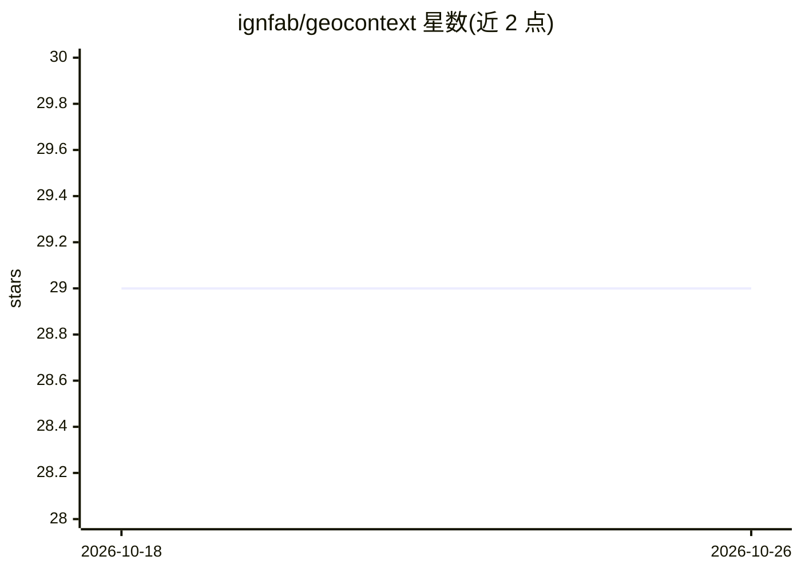

# ignfab/geocontext

⭐ 29 · TypeScript · MIT · 推送 2026-10-23 · [GitHub](https://github.com/ignfab/geocontext) · 组织维护

**面向 AI 助手的法国 Géoplateforme 地理数据 MCP 服务器**

由 IGNfab 孵化的 MCP 服务器原型，让 Claude Desktop、Cursor、GitHub Copilot 等 MCP 兼容客户端通过自然语言查询 IGN Géoplateforme 的法国权威地理数据：地理编码、海拔、路径计算、行政区划、地籍、城市规划文件、WFS 图层查询与下载等 14 个工具。它不托管数据，按需调用 IGN 服务并返回为 LLM 过滤、结构化后的结果以限制 token 用量。提供远程 HTTP 实例与 npx 本地运行两种方式，需 Node.js ≥22.21.0。项目自述为孵化中的原型。

## 筛选速览

| 维度 | 判定 | 备注 |
|---|---|---|
| AI 角色 | `ai-ecosystem` | LLM/agent 周边工具 |
| 许可风险 | `permissive` | MIT |
| 部署形态 | `library` | 以包/库形式分发 |
| 模型依赖 | — | README 未给出锁定关系 |
| 硬件要求 | — | 无带数字的原话,不猜 |
| 安装摩擦 | `low` | 无编译、无系统依赖或容器化 |
| 成熟度 | `idea` | |

## 能力要点

- 14 个 MCP 工具覆盖地理编码、海拔、行政区划、地籍、城市规划、WFS 图层查询
- 不复制数据，按需查询 Géoplateforme 服务并做服务端过滤以限制 token
- 提供远程 HTTP 实例与 npx 本地运行两种接入方式

## 适用场景

- 让 Claude/Cursor 等 AI 助手回答法国地理数据问题（如某市高于 20 米的建筑物数量）
- 通过 WFS 工具按自然语言查询和下载 GPF 图层数据
- 查询法国地籍、行政区划与城市规划文件（PLU/SUP）

## 场景标签

 · 领域:地理信息/政府数据

## 证据(README 行号)

> L7: **Geocontext** est un serveur MCP qui permet aux assistants IA d’interroger les données géographiques françaises de 
> L136: Geocontext agit comme un intermédiaire entre un assistant compatible MCP et les services de la Géoplateforme IGN.
> L138: Il n’héberge pas les données : il expose des outils MCP, interroge les services IGN à la demande, puis retourne au

## 星数曲线

2026-10-18 29 → 2026-10-26 29（+0）

---
*卡片 v1 · prompt 1.4 · 生成 2026-10-26 · 置信度 high · 依据 README sha `70b2c2d220cc` · [字段定义](../../DATASET.md)*
