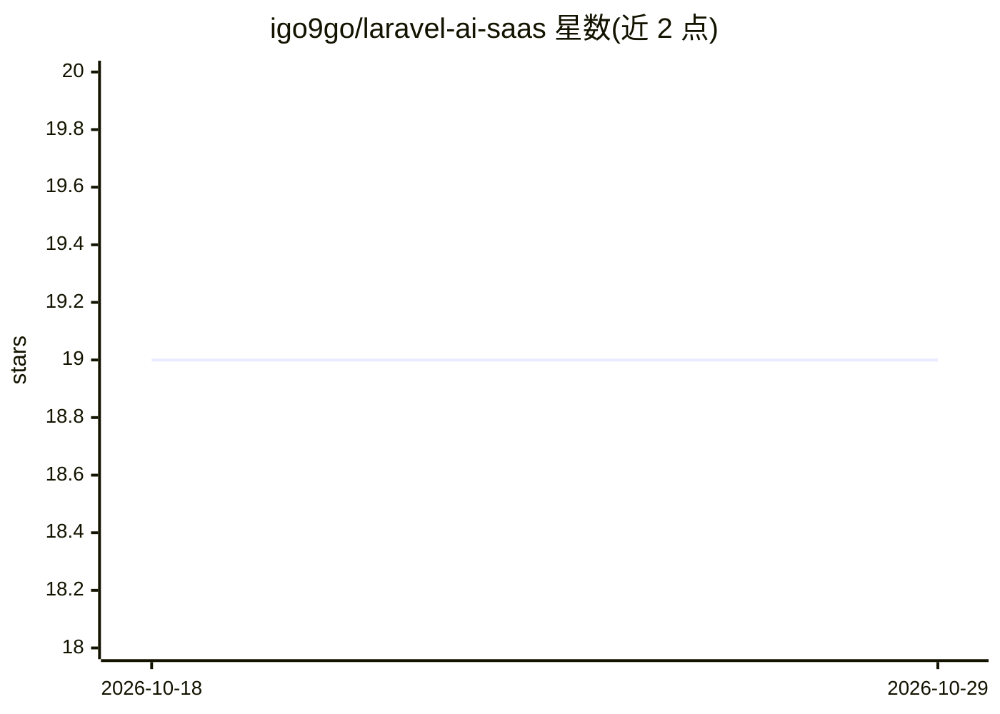

# igo9go/laravel-ai-saas

⭐ 19 · PHP · 推送 2025-12-13 · [GitHub](https://github.com/igo9go/laravel-ai-saas) · 个人维护 · 中文 README

**给开发者的 Laravel AI SaaS 全功能起步模板**

基于 Laravel 12、Livewire 3、Alpine.js 与 Tailwind CSS v4 的 AI SaaS 模板，提供认证（Fortify+Socialite）、Spatie Permission 通配符 RBAC、多支付提供商（Stripe/PayPal/Creem）、多 AI 提供商（Replicate/OpenAI）、多存储（S3/R2）、FIFO 积分扣减（数据库锁）与中英国际化，含管理后台和 REST API（Sanctum Bearer 认证）。要求 PHP 8.2+、Composer、Node.js 18+ 与 PostgreSQL/SQLite，通过 git clone、Composer/npm 安装与 artisan 命令运行。

## 筛选速览

| 维度 | 判定 | 备注 |
|---|---|---|
| AI 角色 | `ai-ecosystem` | LLM/agent 周边工具 |
| 许可风险 | `none` | — |
| 部署形态 | `None` |  |
| 模型依赖 | — | README 未给出锁定关系 |
| 硬件要求 | — | 无带数字的原话,不猜 |
| 安装摩擦 | `low` | 无编译、无系统依赖或容器化 |
| 成熟度 | — | 结构信号不足 |

## 能力要点

- 多支付提供商（Stripe/PayPal/Creem）与 Webhook 处理
- 多 AI 提供商（Replicate/OpenAI），提供生成/查询/流式 API 端点
- FIFO 积分消耗（数据库锁）与四层级通配符 RBAC
- Laravel Sanctum API：用户、支付、AI、聊天四组端点

## 适用场景

- 快速搭建带支付与积分系统的 AI SaaS 产品
- 搭建多提供商 AI 生成/聊天服务并对外提供 API
- 需要 RBAC 与管理后台的订阅制 Web 应用起步

## 场景标签

 · 领域:Web 开发/SaaS 模板

## 证据(README 行号)

> L3: A full-featured AI SaaS boilerplate built with Laravel 12, Livewire 3, and Tailwind CSS.
> L10: - **AI Integration**: Multi-provider support (Replicate, OpenAI)

## 星数曲线

2026-10-18 19 → 2026-10-29 19（+0）

---
*卡片 v1 · prompt 1.4 · 生成 2026-10-28 · 置信度 high · 依据 README sha `9ffc3a0aff0e` · [字段定义](../../DATASET.md)*
