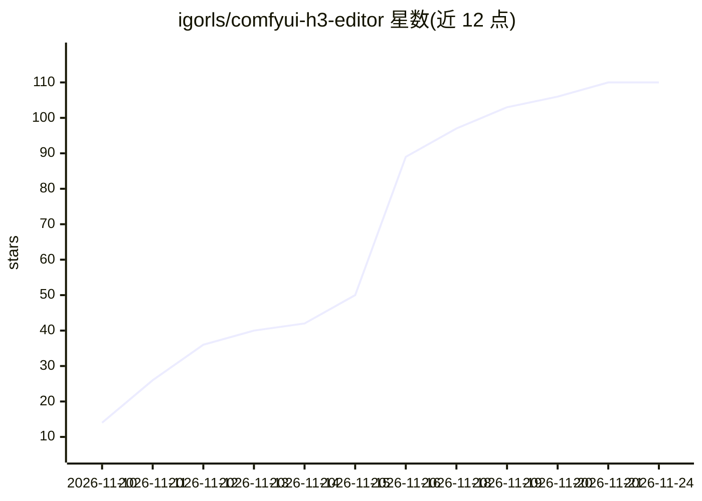

# igorls/comfyui-h3-editor

⭐ 111 · Python · GPL-3.0 · 推送 2026-11-23 · [GitHub](https://github.com/igorls/comfyui-h3-editor) · [官网](https://igorls.github.io/comfyui-h3-editor/) · 个人维护

**ComfyUI 内的 MiniMax H3 时间线 AI 视频编辑器**

以 ComfyUI 自定义节点包形式提供的时间线视频编辑器：用文字描述镜头，编辑器自动构建 ComfyUI 图并渲染，在自有 GPU 上生成含声音的视频片段；支持角色/场景参考图保持一致性、镜头延长/桥接/合并、剪辑与音乐旁白轨、导入自有素材并导出成片。内置 HyperFlow H3 Flash、MiniMax H3 等多种 H3 模型与 LoRA，可接其他节点的加速组件；语言模型可代写镜头，支持 OpenAI 兼容端点、Anthropic、Gemini、Ollama 或 ComfyUI 内文本模型。全部功能暴露为 HTTP 调用，附 agent 技能；需 ComfyUI 0.43+，首批模型约 54 GB。

## 筛选速览

| 维度 | 判定 | 备注 |
|---|---|---|
| AI 角色 | `ai-native` | 本体是模型或模型工具 |
| 许可风险 | `viral` | GPL-3.0 |
| 部署形态 | `desktop` | 安装包/桌面程序 |
| 模型依赖 | local-ok | 支持本地模型 |
| 硬件要求 | — | 无带数字的原话,不猜 |
| 安装摩擦 | `medium` | 含编译或系统依赖之一 |
| 成熟度 | — | 结构信号不足 |

## 能力要点

- 文字描述镜头，自动构建 ComfyUI 图并带声渲染
- 角色参考图（每人最多 8 张）+ @Name 保持人物/场景一致
- 镜头延长、桥接、合并可承接真实帧与声音，避免可见切换
- 语言模型代写镜头（OpenAI 兼容/Anthropic/Gemini/Ollama），全流程可由 agent 经 HTTP 调用完成
- 内置多款 H3 模型与 LoRA 预设，成片最高 1920 像素

## 适用场景

- 在本地 GPU 上从文字镜头描述生成并剪辑完整视频
- 用固定角色和声音制作多镜头叙事短片
- 让语言模型或 agent 根据帧上批注自动修改视频

## 场景标签

`视频生成` · 领域:内容生成

## 证据(README 行号)

> L13: - **Write shots, not graphs.** Describe what happens and what is said. The
> L60: You need a recent ComfyUI with its built-in MiniMax H3 support: 0.43 or newer.

## 星数曲线

2026-11-10 14 → 2026-11-24 110（+96）

---
*卡片 v1 · prompt 1.4 · 生成 2026-11-17 · 置信度 mid · 依据 README sha `3670e6647961` · [字段定义](../../DATASET.md)*
