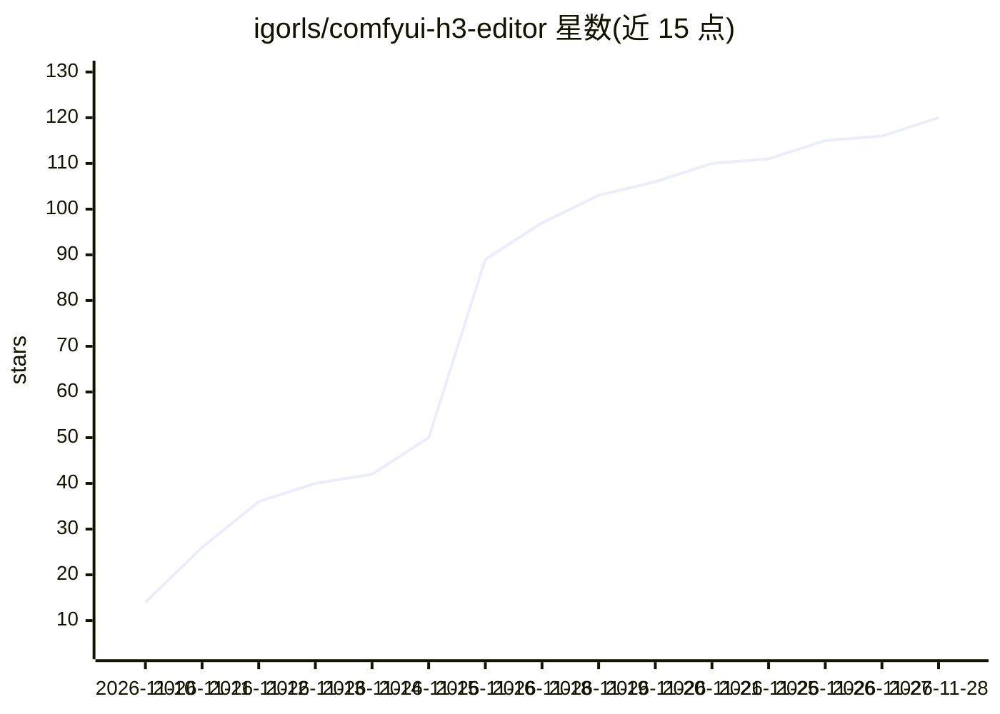

# igorls/comfyui-h3-editor

⭐ 120 · Python · GPL-3.0 · 推送 2026-11-27 · [GitHub](https://github.com/igorls/comfyui-h3-editor) · [官网](https://igorls.github.io/comfyui-h3-editor/) · 个人维护

**ComfyUI 内的 MiniMax H3 时间线视频编辑器，可让 agent 生成视频**

作为 ComfyUI 自定义节点运行的时间线视频编辑器：用户用文字描述镜头，编辑器构建 ComfyUI 工作流并由本地 GPU 渲染视频片段，支持角色一致性（@Name 引用）、片段扩展拼接、音频混音、转场与导出。内置多个 H3 系模型与 LoRA 选择，也可接入任意 OpenAI 兼容端点、Anthropic、Gemini 或 Ollama 让语言模型撰写镜头文本；全部功能以 HTTP 调用暴露并附带 agent skill。依赖较新的 ComfyUI（0.43+）并需下载约 54 GB 模型文件。

## 筛选速览

| 维度 | 判定 | 备注 |
|---|---|---|
| AI 角色 | `ai-native` | 本体是模型或模型工具 |
| 许可风险 | `viral` | GPL-3.0 |
| 部署形态 | `desktop` | 安装包/桌面程序 |
| 模型依赖 | local-ok | 支持本地模型 |
| 硬件要求 | — | 无带数字的原话,不猜 |
| 安装摩擦 | `medium` | 含编译或系统依赖之一 |
| 成熟度 | — | 结构信号不足 |

## 能力要点

- 在 ComfyUI 内以文字写镜头并直接渲染带声音的视频片段
- cast 图像保持人物一致，@Name 引用并可为角色配音
- 全部编辑操作为 HTTP 调用，附带 agent skill 供 agent 使用
- 支持任意 H3 checkpoint、LoRA 与其他加速节点包接入

## 适用场景

- 在自己 GPU 上用文字生成并剪辑短片
- 保持同一角色跨镜头一致的多镜头视频制作
- 让 agent 按工作流自动生成视频

## 场景标签

`视频生成` · 领域:内容生成

## 证据(README 行号)

> L3: A timeline video editor for MiniMax H3, inside ComfyUI. Write your shots,
> L53: - **Let an agent make the video.** Everything the editor does is an HTTP call,
> L42: - **Let a language model write.** Describe the video and it writes the shots as

## 星数曲线

2026-11-10 14 → 2026-11-28 120（+106）

---
*卡片 v1 · prompt 1.4 · 生成 2026-11-28 · 置信度 high · 依据 README sha `198e1de592bd` · [字段定义](../../DATASET.md)*
