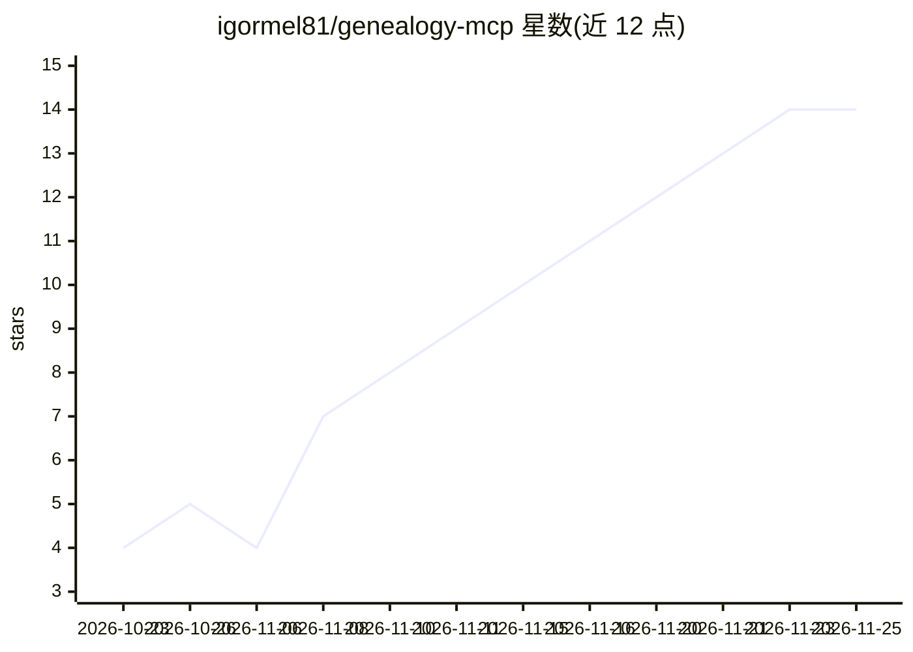

# igormel81/genealogy-mcp

⭐ 14 · Python · MIT · 推送 2026-11-15 · [GitHub](https://github.com/igormel81/genealogy-mcp) · [官网](https://github.com/igormel81/genealogy-mcp#readme) · 个人维护 · 中文 README

**把 AI 助手变成家谱研究者的 MCP 工具包**

一个 MCP 服务器，为支持 MCP 的 AI 助手提供家谱研究能力：收录 179 个档案与数据库的检索指南，提供 31 个工具，覆盖姓名变体与 9 种转写系统、儒略/希伯来/法国共和历、教会节日日期、教堂斯拉夫语数字、三种语言亲属关系与 DNA 共享度推算、GEDCOM 树审计与原地编辑（先预览后写入并保留副本），并可与 gene-archive 家族网站集成实现经校验的编辑、git 提交与站点重建。研究项目与日志保存在本地。安装依赖 uv/uvx，支持 Docker。

## 筛选速览

| 维度 | 判定 | 备注 |
|---|---|---|
| AI 角色 | `ai-ecosystem` | LLM/agent 周边工具 |
| 许可风险 | `permissive` | MIT |
| 部署形态 | `self-host` | docker 或自建部署 |
| 模型依赖 | — | README 未给出锁定关系 |
| 硬件要求 | — | 无带数字的原话,不猜 |
| 安装摩擦 | `low` | 无编译、无系统依赖或容器化 |
| 成熟度 | — | 结构信号不足 |

## 能力要点

- 179 个跨 55 国档案数据库的检索指南与访问指引
- 31 个工具：姓名转写、历史历法、亲属关系、DNA、证据核查、树审计
- GEDCOM 原地编辑：仅改变更行、保留字节级副本、先预览后写入
- 与 gene-archive 站点集成，编辑经校验并提交 git、重建站点

## 适用场景

- 让 Claude Desktop 等助手按国家与年代定位祖先档案
- 审计与修正 MyHeritage/Ancestry/Gramps 导出的 GEDCOM 家谱树
- 解读旧历法日期与教堂斯拉夫语数字记录
- 管理带引用与检索日志的家谱研究项目

## 场景标签

 · 领域:家谱研究/工具

## 证据(README 行号)

> L11: An MCP server that turns Claude, ChatGPT, Cursor or any MCP-capable assistant into a
> L28: - **31 tools** for the real work of a genealogist: name variants and 9 transliteration systems, Daitch–Mokotoff,

## 星数曲线

2026-10-23 4 → 2026-11-25 14（+10）

---
*卡片 v1 · prompt 1.4 · 生成 2026-11-18 · 置信度 high · 依据 README sha `08674a677edb` · [字段定义](../../DATASET.md)*
