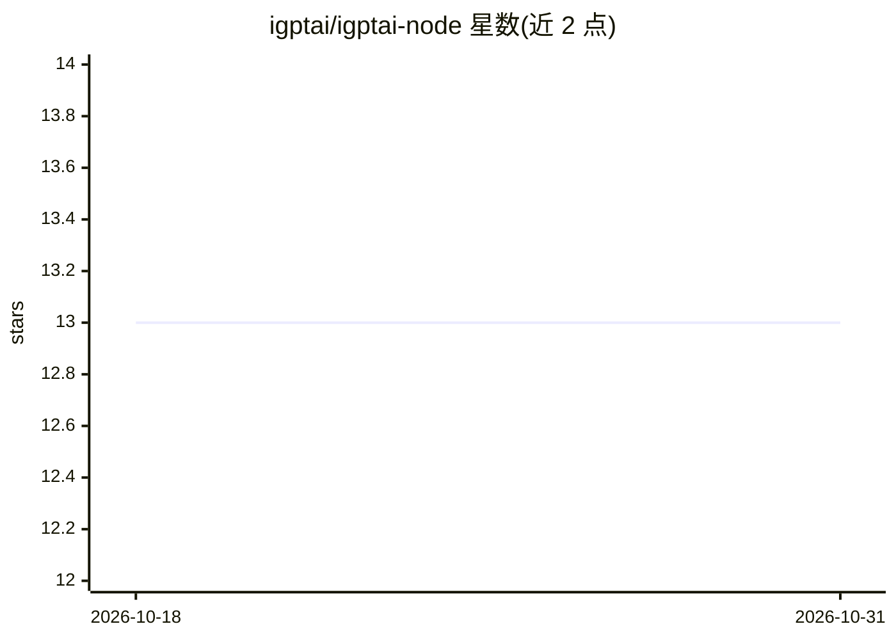

# igptai/igptai-node

⭐ 13 · JavaScript · MIT · 推送 2026-07-19 · [GitHub](https://github.com/igptai/igptai-node) · [官网](https://www.igpt.ai) · 组织维护

**iGPT API 的官方 Node.js SDK：连接数据源并生成 agentic 回答**

面向 Node.js >= 18 的官方 SDK，封装 iGPT API：通过 connectors.authorize() 为终端用户发起数据源（如 Spike 邮件）授权并索引；recall.run() 基于已连接上下文执行多轮推理、调用内部工具并生成回答，支持流式事件、text/JSON/JSON Schema 三种输出格式及 reasoning_effort 参数；另有 recall.search() 检索与 datasources 管理接口。需 Bearer API key 认证，流式请求不重试。

## 筛选速览

| 维度 | 判定 | 备注 |
|---|---|---|
| AI 角色 | `ai-ecosystem` | LLM/agent 周边工具 |
| 许可风险 | `permissive` | MIT |
| 部署形态 | `library` | 以包/库形式分发 |
| 模型依赖 | — | README 未给出锁定关系 |
| 硬件要求 | — | 无带数字的原话,不猜 |
| 安装摩擦 | `low` | 无编译、无系统依赖或容器化 |
| 成熟度 | — | 结构信号不足 |

## 能力要点

- connectors.authorize() 发起数据源授权与索引流程
- recall.run() 支持多轮推理、工具调用与流式事件（run.start→run.done 生命周期）
- 输出格式支持 text/JSON/JSON Schema 结构化输出
- README 详细文档化流式事件对象结构与 usage/sources 元数据

## 适用场景

- 在我的应用中让用户连接邮件等数据源并获得基于其上下文的 AI 回答
- 对用户已连接的数据源执行带日期过滤的检索
- 以 JSON Schema 约束输出，获取机器可读的摘要或行动项

## 场景标签

`RAG` · 领域:知识与检索

## 证据(README 行号)

> L3: Official Node.js SDK for the iGPT API.
> L97: Generate an agentic response based on the provided input and the end-user’s connected context.

## 星数曲线

2026-10-18 13 → 2026-10-31 13（+0）

---
*卡片 v1 · prompt 1.4 · 生成 2026-10-31 · 置信度 high · 依据 README sha `995704eef2fa` · [字段定义](../../DATASET.md)*
