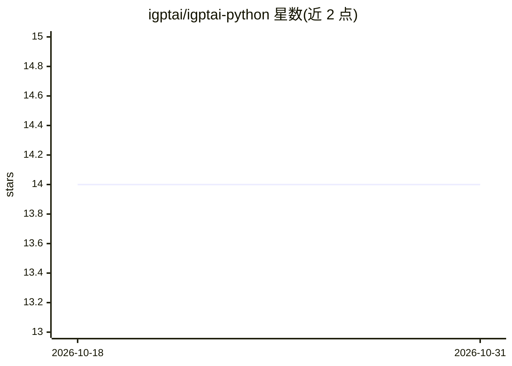

# igptai/igptai-python

⭐ 14 · Python · MIT · 推送 2026-07-16 · [GitHub](https://github.com/igptai/igptai-python) · [官网](http://www.igpt.ai) · 组织维护

**iGPT API 官方 Python SDK：接入数据源并生成代理式回答**

iGPT 官方 Python 库，封装 iGPT API 的连接器授权、数据源管理与代理式调用。典型流程：先为终端用户发起数据源（如 Spike 邮件）授权并建立索引，再通过 recall.run() 基于该用户已连接上下文生成回答，支持多轮推理、内部工具调用、流式事件（run.start 到 run.done 的完整生命周期）、text/JSON/JSON Schema 结构化输出及可调 reasoning_effort 与 quality 参数。需 Bearer token 认证，要求 Python>=3.8，pip 安装。

## 筛选速览

| 维度 | 判定 | 备注 |
|---|---|---|
| AI 角色 | `ai-ecosystem` | LLM/agent 周边工具 |
| 许可风险 | `permissive` | MIT |
| 部署形态 | `library` | 以包/库形式分发 |
| 模型依赖 | — | README 未给出锁定关系 |
| 硬件要求 | — | 无带数字的原话,不猜 |
| 安装摩擦 | `low` | 无编译、无系统依赖或容器化 |
| 成熟度 | — | 结构信号不足 |

## 能力要点

- connectors.authorize() 数据源授权连接与索引（含进度、时间范围等元数据）
- recall.run() 代理式回答：多轮推理、内部工具调用、来源聚合
- 流式事件生命周期（run.start/run.done，含 seq 顺序与工具调用配对 callId）
- 支持 text/JSON/JSON Schema 三种输出格式与 recall.search() 数据源检索

## 适用场景

- 在我的应用里为终端用户连接邮件等数据源并建立索引
- 让 AI 基于用户已连接上下文总结未读邮件或会议
- 以结构化 JSON Schema 约束代理输出供下游程序消费
- 流式消费代理运行的推理与工具调用过程

## 场景标签

`RAG` `语义搜索` · 领域:知识与检索

## 证据(README 行号)

> L3: Official Python SDK for the iGPT API.
> L95: Generate an agentic response based on the provided input and the end-user’s connected context.

## 星数曲线

2026-10-18 14 → 2026-10-31 14（+0）

---
*卡片 v1 · prompt 1.4 · 生成 2026-10-31 · 置信度 high · 依据 README sha `9c878c5b01f7` · [字段定义](../../DATASET.md)*
