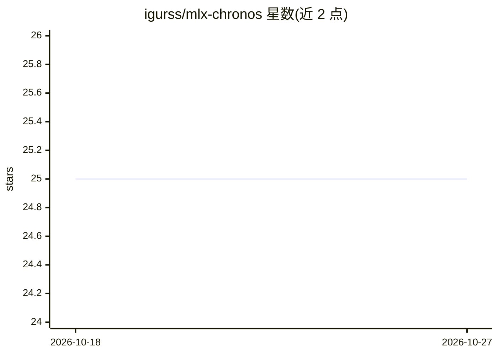

# igurss/mlx-chronos

⭐ 25 · Python · Apache-2.0 · 推送 2026-10-11 · [GitHub](https://github.com/igurss/mlx-chronos) · 个人维护

**Apple Silicon 本地 LLM 推理引擎基准测试套件与社区排行榜**

面向 Apple Silicon Mac 的本地 LLM 推理基准测试工具：检测硬件与运行中的 OpenAI 兼容引擎服务端，按固定协议测量 TTFT、吞吐、RAM 峰值、交换增长与热状态等指标，输出密封 JSON 结果，可提交至社区公共排行榜。支持 Ollama、oMLX、Rapid-MLX、vllm-mlx、mlx-lm、mlx-serve 及 LM Studio（仅限 MLX 运行时）。提供 CLI（pip 安装）与 SwiftUI macOS 应用（DMG 下载）；工具不负责启动引擎或下载模型权重。

## 筛选速览

| 维度 | 判定 | 备注 |
|---|---|---|
| AI 角色 | `ai-ecosystem` | LLM/agent 周边工具 |
| 许可风险 | `permissive` | Apache-2.0 |
| 部署形态 | `library` | 以包/库形式分发 |
| 模型依赖 | local-ok | 支持本地模型 |
| 硬件要求 | — | 无带数字的原话,不猜 |
| 安装摩擦 | `low` | 无编译、无系统依赖或容器化 |
| 成熟度 | — | 结构信号不足 |

## 能力要点

- 固定协议基准：TTFT 冷/缓存、请求吞吐、持续吞吐等指标
- 测量系统 RAM 峰值、交换增长与热状态等 Mac 环境数据
- 密封 JSON 结果与公共排行榜提交校验（--publishable 快速失败检查）
- CLI 向导（wizard）与 doctor 环境诊断命令

## 适用场景

- 我在多台 Mac 上对比本地推理引擎的 TTFT 与吞吐表现
- 我想用可复现的固定协议测出结果并提交社区排行榜
- 提交前用 submit --dry-run 校验结果是否符合公共排行榜要求

## 场景标签

`模型评测` · 领域:评测与运维

## 证据(README 行号)

> L67: `mlx-chronos` is a standardized benchmark tool for local LLM inference engines
> L132: ## Supported Engines
> L69: an OpenAI-compatible engine endpoint, and writes structured result files for

## 星数曲线

2026-10-18 25 → 2026-10-27 25（+0）

---
*卡片 v1 · prompt 1.4 · 生成 2026-10-27 · 置信度 high · 依据 README sha `02d1a23c5820` · [字段定义](../../DATASET.md)*
