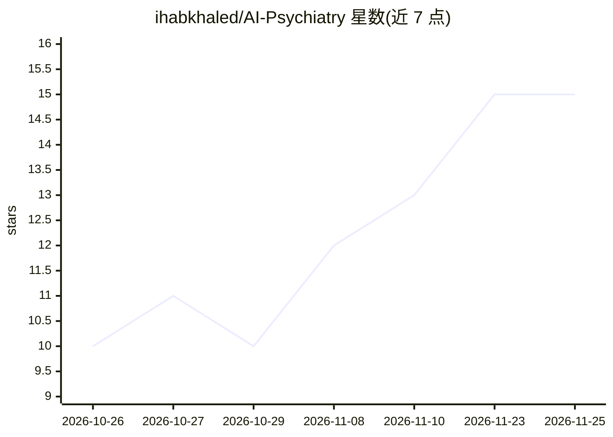

# ihabkhaled/AI-Psychiatry

⭐ 15 · Python · MIT · 推送 2026-10-03 · [GitHub](https://github.com/ihabkhaled/AI-Psychiatry) · [官网](https://claw-ai.co) · 个人维护

**为 AI 编码代理提供执行控制层的 Claude 插件**

以 Claude Code 插件形式分发的行为控制层，同时支持 Codex 与 Cursor：通过单一常驻技能 all-the-medicine，经 SessionStart/UserPromptSubmit 钩子、AGENTS.md 标记块或 Cursor 规则注入，检测并干预注意力漂移、过度思考、递归推理、强迫性验证、范围漂移、重试循环、死锁/活锁、上下文浪费与虚假完成等失败模式。框架安装含 59 条规则、49 个操作技能与语义策略的 .ai/ 运行时；仅含本地钩子脚本，不添加 MCP 服务器、网络服务或数据采集。

## 筛选速览

| 维度 | 判定 | 备注 |
|---|---|---|
| AI 角色 | `ai-ecosystem` | LLM/agent 周边工具 |
| 许可风险 | `permissive` | MIT |
| 部署形态 | `None` |  |
| 模型依赖 | — | README 未给出锁定关系 |
| 硬件要求 | — | 无带数字的原话,不猜 |
| 安装摩擦 | `low` | 无编译、无系统依赖或容器化 |
| 成熟度 | — | 结构信号不足 |

## 能力要点

- 单一常驻技能 all-the-medicine，无需手动输入，重运行即更新、--uninstall 可逐字节还原
- 约 25 个命名控制文件，按观察到的行为选择（如 stop-overthinking、evidence-gate、completion-gate）
- 支持 Claude Code、Codex、Cursor 三平台的显式安装路径与按仓库/按会话安装
- 声明无 MCP 服务器、网络服务、分析或数据收集，钩子仅打印文本

## 适用场景

- 让长时间自主运行的编码代理不陷入循环或提前宣称完成
- 为 Claude Code/Codex/Cursor 会话统一注入行为约束规则
- 调试代理在仓库中跳过证据、扩大范围等失败模式

## 场景标签

`编码 Agent` · 领域:编码与开发

## 证据(README 行号)

> L3: AI-PSYCHIATRY IS NOT OPTIONAL. Always-on executive control for Claude Code, Codex and Cursor: it stops agents from s
> L27: |Claude Code|`claude plugin marketplace add https://github.com/ihabkhaled/AI-Psychiatry.git`, then `claude plugin i
> L44: |Behavior|Control|

## 星数曲线

2026-10-26 10 → 2026-11-25 15（+5）

---
*卡片 v1 · prompt 1.4 · 生成 2026-11-18 · 置信度 high · 依据 README sha `b8b30bb7550a` · [字段定义](../../DATASET.md)*
