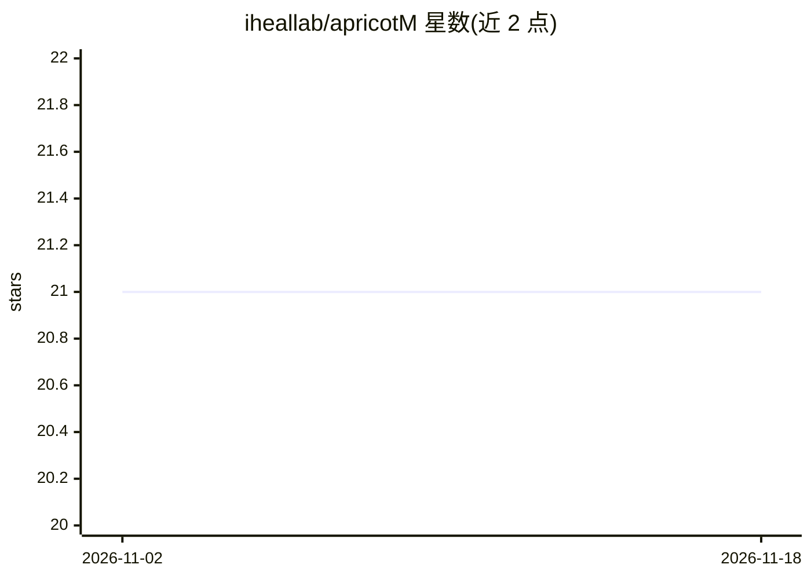

# iheallab/apricotM

⭐ 21 · Python · 推送 2026-11-02 · [GitHub](https://github.com/iheallab/apricotM) · 组织维护

**ICU 患者病情严重度实时预测的深度学习框架代码**

论文官方代码库：基于 EHR 数据（eICU、MIMIC-IV 等）训练深度学习模型，实时预测 ICU 患者病情严重度与治疗需求。核心为 APRICOT-Mamba，集成 Mamba 状态空间模型与 Transformer 架构，并含 GRU、CatBoost 等基线。提供数据预处理、Optuna 超参优化训练、评估、前瞻应用与校准/特征归因分析脚本。需 Python 3.8+、PyTorch，训练推荐 NVIDIA CUDA GPU，数据集需单独申请访问权限。

## 筛选速览

| 维度 | 判定 | 备注 |
|---|---|---|
| AI 角色 | `ai-native` | 本体是模型或模型工具 |
| 许可风险 | `none` | — |
| 部署形态 | `library` | 以包/库形式分发 |
| 模型依赖 | — | README 未给出锁定关系 |
| 硬件要求 | — | 无带数字的原话,不猜 |
| 安装摩擦 | `medium` | 含编译或系统依赖之一 |
| 成熟度 | — | 结构信号不足 |

## 能力要点

- Mamba 状态空间模型与 Transformer 架构结合的 APRICOT-Mamba 模型
- 覆盖预处理、训练、评估、前瞻应用与后分析（校准、特征归因）的完整流程
- 支持 eICU、MIMIC-IV 与机构内部 EHR 数据源
- 含 GRU、CatBoost、Transformer 等基线对比脚本

## 适用场景

- 复现论文中的 ICU 患者严重度预测实验
- 在 eICU/MIMIC-IV 数据上训练与评估危重症预测模型
- 对预测结果做校准分析与特征归因分析

## 场景标签

 · 领域:医疗健康/临床预测

## 证据(README 行号)

> L19: **APRICOT-Mamba** is a deep learning framework designed to continuously predict patient acuity in the ICU using Ele
> L24: - Training and evaluation scripts for APRICOT-Mamba, APRICOT-Transformer, GRU, CatBoost, and Transformer baselines.

## 星数曲线

2026-11-02 21 → 2026-11-18 21（+0）

---
*卡片 v1 · prompt 1.4 · 生成 2026-11-18 · 置信度 high · 依据 README sha `eee2e12a8e00` · [字段定义](../../DATASET.md)*
