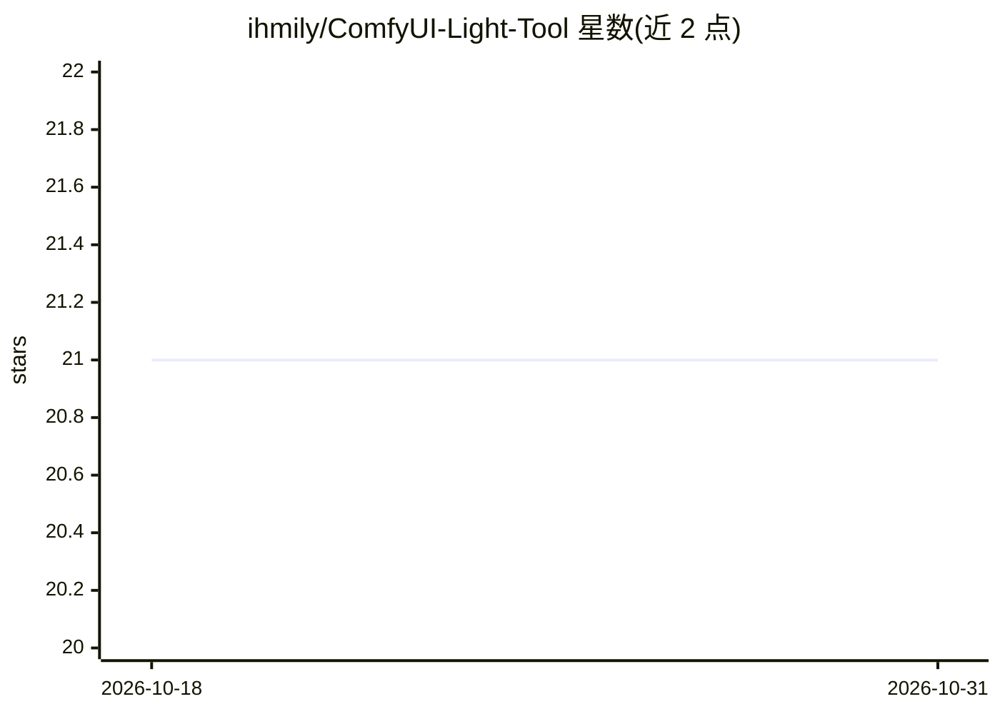

# ihmily/ComfyUI-Light-Tool

⭐ 21 · Python · MIT · 推送 2026-04-28 · [GitHub](https://github.com/ihmily/ComfyUI-Light-Tool) · [官网](https://registry.comfy.org/nodes/comfyui-light-tool) · 个人维护 · 中文 README

**ComfyUI 轻量自定义工具节点套件：图像/文本/视频/数据处理**

面向 ComfyUI 用户的自定义工具节点集合，覆盖五大类功能：图像处理（加载、合成叠加、缩放裁剪、蒙版操作、颜色通道转换、信息读取）、文本处理（输入、连接、替换、显示）、视频相关（URL 下载、预览、保存、上传阿里云 OSS）、数据处理（颜色码转换、计算、JSON 解析序列化）与实用工具（幻影坦克效果、元数据读写、文件上传 OSS）。支持手动克隆到 custom_nodes 目录或经 ComfyUI-Manager 安装。节点本身不产出模型推理结果，属于工作流辅助工具。

## 筛选速览

| 维度 | 判定 | 备注 |
|---|---|---|
| AI 角色 | `ai-ecosystem` | LLM/agent 周边工具 |
| 许可风险 | `permissive` | MIT |
| 部署形态 | `None` |  |
| 模型依赖 | — | README 未给出锁定关系 |
| 硬件要求 | — | 无带数字的原话,不猜 |
| 安装摩擦 | `low` | 无编译、无系统依赖或容器化 |
| 成熟度 | — | 结构信号不足 |

## 能力要点

- 图像合成、缩放、裁剪、蒙版操作等 40+ 个节点
- 文本与 JSON 数据处理节点（替换、序列化、按键取值等）
- 视频下载/预览及上传阿里云 OSS 节点
- PNG 元数据（workflow/prompt）写入与读取

## 适用场景

- 在 ComfyUI 工作流中批量加载、缩放与合成图像
- 处理蒙版与透明通道以配合 VAE 等节点使用
- 将生成结果上传阿里云 OSS 或嵌入元数据保存

## 场景标签

`图像视频处理` · 领域:感知与多模态

## 证据(README 行号)

> L5: A suite of lightweight and practical custom tool nodes for ComfyUI to enhance workflow efficiency and flexibility.
> L13: cd ComfyUI/custom_nodes

## 星数曲线

2026-10-18 21 → 2026-10-31 21（+0）

---
*卡片 v1 · prompt 1.4 · 生成 2026-10-28 · 置信度 high · 依据 README sha `1c5d8b2d8aca` · [字段定义](../../DATASET.md)*
