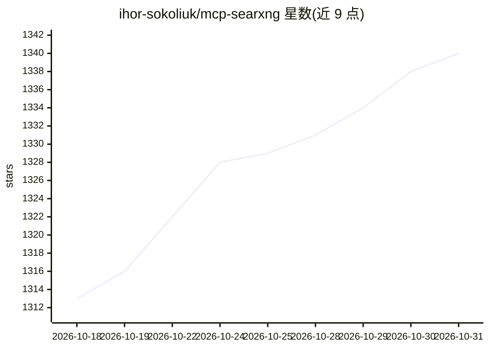

# ihor-sokoliuk/mcp-searxng

⭐ 1,340 · TypeScript · MIT · 推送 2026-10-27 · [GitHub](https://github.com/ihor-sokoliuk/mcp-searxng) · [官网](https://www.npmjs.com/package/mcp-searxng) · 个人维护

**为 AI 助手接入 SearXNG 隐私搜索的 MCP 服务器**

一个连接 SearXNG API 的 MCP 服务器，使 Claude Desktop、Cursor 等 MCP 客户端获得网页搜索与 URL 读取能力。要求用户提供已启用 JSON 输出的 SearXNG 实例（自行部署或信任的公共实例），本产品不安装 SearXNG。提供四个工具：网页搜索、查询建议、实例信息检查、URL/PDF 文本读取；支持 STDIO 与 Streamable HTTP 传输、静态 bearer 与可选 OAuth 认证、副本故障转移与缓存。安装途径包括 npm 全局安装、NPX、Docker 镜像与 Docker Compose（需 Node.js 22+，Docker 镜像自带运行时）。

## 筛选速览

| 维度 | 判定 | 备注 |
|---|---|---|
| AI 角色 | `ai-ecosystem` | LLM/agent 周边工具 |
| 许可风险 | `permissive` | MIT |
| 部署形态 | `self-host` | docker 或自建部署 |
| 模型依赖 | — | README 未给出锁定关系 |
| 硬件要求 | — | 无带数字的原话,不猜 |
| 安装摩擦 | `low` | 无编译、无系统依赖或容器化 |
| 成熟度 | — | 结构信号不足 |

## 能力要点

- 提供 searxng_web_search、web_url_read 等 4 个 MCP 工具
- 支持 STDIO 与 Streamable HTTP 传输，含静态 bearer/OAuth 认证
- 可选副本故障转移/扇出、HTML 回退、缓存、代理与浏览器求解器
- 提供预构建 Docker 镜像与 Docker Compose 部署方式

## 适用场景

- 让 Claude Desktop、Cursor 等 MCP 客户端通过自托管 SearXNG 搜索网页
- 在私有部署中为 AI 助手提供不依赖付费搜索 API 的检索能力
- 让 agent 读取指定 URL 的文本或 PDF 内容作为上下文

## 场景标签

`网页抓取` · 领域:效率与自动化

## 证据(README 行号)

> L15: An MCP server that integrates the SearXNG API, giving AI assistants web search capabilities.
> L96: `MCP client → mcp-searxng → SearXNG → search engines`

## 星数曲线

2026-10-18 1,313 → 2026-10-31 1,340（+27）

---
*卡片 v1 · prompt 1.4 · 生成 2026-10-21 · 置信度 high · 依据 README sha `c0173c70d68a` · [字段定义](../../DATASET.md)*
