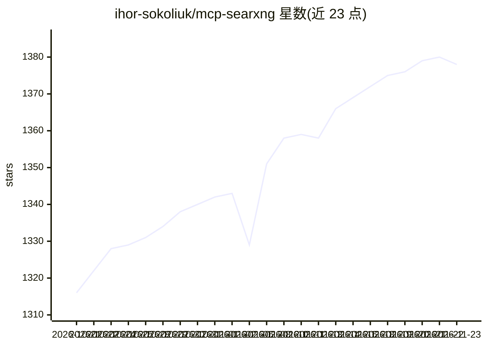

# ihor-sokoliuk/mcp-searxng

⭐ 1,378 · TypeScript · MIT · 推送 2026-11-17 · [GitHub](https://github.com/ihor-sokoliuk/mcp-searxng) · [官网](https://www.npmjs.com/package/mcp-searxng) · 个人维护

**为 AI 助手提供 SearXNG 私密网络搜索的 MCP 服务器**

一个集成 SearXNG API 的 MCP 服务器，为 Claude、Cursor 等 MCP 客户端提供网络搜索能力。提供四个工具：网页搜索（带分页与过滤）、查询建议、实例能力查询、URL 读取（HTML/结构化文本/受限 PDF 文本）。支持 STDIO 与 Streamable HTTP 两种传输方式，可配置静态 bearer 或 OAuth 认证。前置条件是用户需自行运行或信任一个开启 JSON 输出的 SearXNG 实例；隐私取决于该实例的部署方式，本身不提供匿名性。

## 筛选速览

| 维度 | 判定 | 备注 |
|---|---|---|
| AI 角色 | `ai-ecosystem` | LLM/agent 周边工具 |
| 许可风险 | `permissive` | MIT |
| 部署形态 | `self-host` | docker 或自建部署 |
| 模型依赖 | — | README 未给出锁定关系 |
| 硬件要求 | — | 无带数字的原话,不猜 |
| 安装摩擦 | `low` | 无编译、无系统依赖或容器化 |
| 成熟度 | — | 结构信号不足 |

## 能力要点

- 4 个 MCP 工具：网页搜索、查询建议、实例信息、URL 读取
- STDIO 与 Streamable HTTP 传输，支持 bearer/OAuth 认证
- 可选副本故障转移、HTML 回退、缓存与浏览器求解器集成
- 无需付费搜索厂商 API key

## 适用场景

- 让 Claude Desktop 或 Cursor 通过自托管 SearXNG 搜索网络
- 读取指定 URL 内容作为文本/Markdown 供 AI 引用
- 在不可控的公共实例与自控实例间做隐私取舍的搜索接入

## 场景标签

`网页抓取` · 领域:效率与自动化

## 证据(README 行号)

> L15: An MCP server that integrates the SearXNG API, giving AI assistants web search capabilities.
> L21: You need an existing **SearXNG instance with JSON search enabled**. This project
> L126: The project-maintained distribution methods are **npm** (including **npx**)

## 星数曲线

2026-10-21 1,316 → 2026-11-23 1,378（+62）

---
*卡片 v1 · prompt 1.4 · 生成 2026-11-23 · 置信度 high · 依据 README sha `b5b802325fe1` · [字段定义](../../DATASET.md)*
