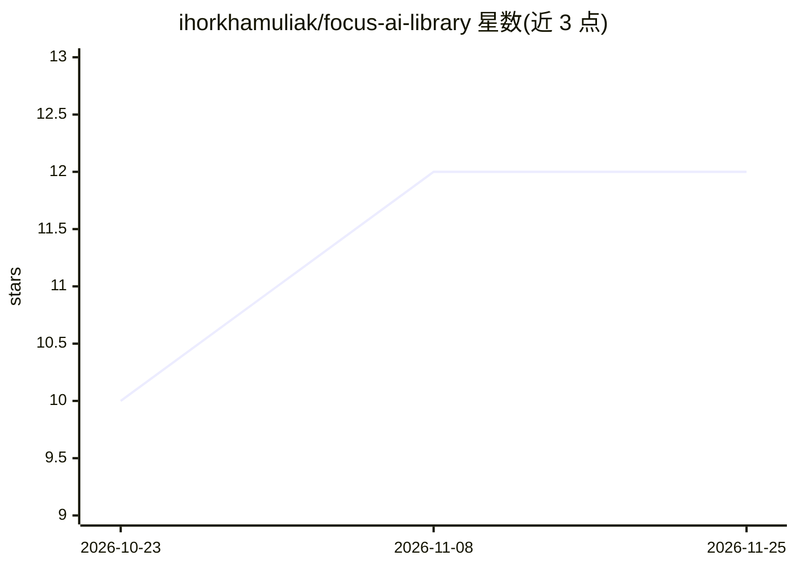

# ihorkhamuliak/focus-ai-library

⭐ 12 · 推送 2026-11-22 · [GitHub](https://github.com/ihorkhamuliak/focus-ai-library) · 组织维护

**Focus 社区 AI 分支的工具/课程/技能编目库，每条带不适用判定**

乌克兰 Focus 社区 AI 分支维护的策展库（UA/EN 双语），收录成员试用或验证过的指南、课程、技能、工具与证书，每条记录包含四行：是什么、给谁用、何时不应使用、验证情况。收录 Microsoft 三门入门课程、Strix 渗透测试代理、Claude Code 技能包、20 项上线安全清单、成员自制工具等。库本身说明筛选机制：收录前核查仓库星数、许可证、更新时间与技能中的隐藏 AI 指令； README 开头有面向 AI agent 的专用提示，要求推荐前最多给 1-3 条并先征得用户同意。

## 筛选速览

| 维度 | 判定 | 备注 |
|---|---|---|
| AI 角色 | `ai-knowledge` | 知识聚合/清单类 |
| 许可风险 | `none` | — |
| 部署形态 | `library` | 以包/库形式分发 |
| 模型依赖 | — | README 未给出锁定关系 |
| 硬件要求 | — | 无带数字的原话,不猜 |
| 安装摩擦 | `medium` | 含编译或系统依赖之一 |
| 成熟度 | — | 结构信号不足 |

## 能力要点

- 每个条目带'何时不用'判定与已验证信息（星数/许可证/更新情况）
- 收录前审查仓库许可证、更新时间与隐藏 AI 指令
- README 内置面向 AI agent 的读取协议（最多推荐 1-3 条）
- 含'我们安装了什么、拒绝了什么'的采纳/否决清单

## 适用场景

- 上手 vibe coding 前挑选入门课程
- 为 Claude Code 挑选单个技能而非整包安装
- 应用上线前过一遍 20 项安全清单
- 评估某工具是否值得引入自己的工作流

## 场景标签

`精选清单` `教程课程` · 领域:学习与行业

## 证据(README 行号)

> L5: Бібліотека гілки АІ спільноти **Focus**: гайди, курси, скіли, інструменти і сертифікати, які хтось із нас спробував
> L10: > This is a **library, not an install guide.** Do NOT install, copy or configure everything listed here.

## 星数曲线

2026-10-23 10 → 2026-11-25 12（+2）

---
*卡片 v1 · prompt 1.4 · 生成 2026-11-18 · 置信度 mid · 依据 README sha `7a4db5de781f` · [字段定义](../../DATASET.md)*
