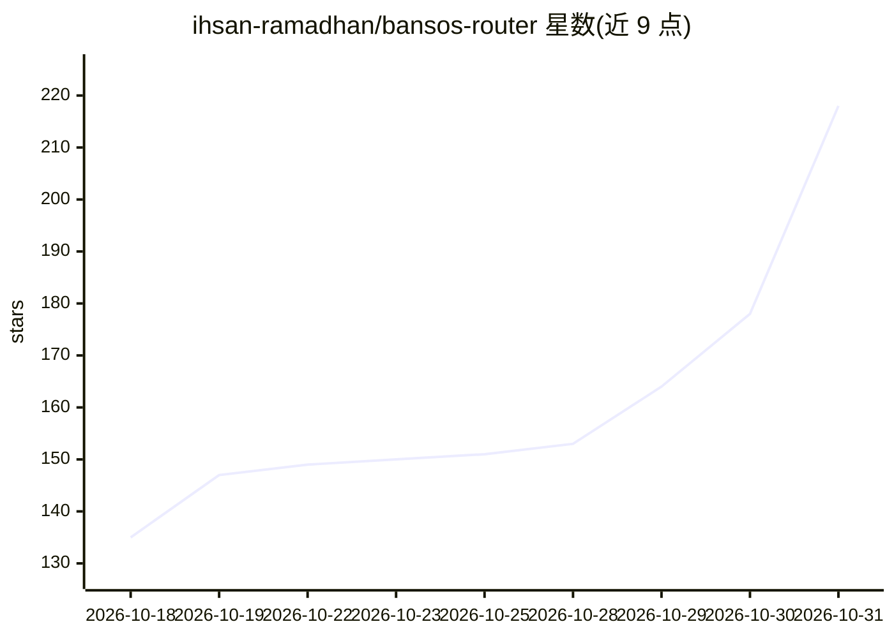

# ihsan-ramadhan/bansos-router

⭐ 218 · TypeScript · GPL-3.0 · 推送 2026-10-27 · [GitHub](https://github.com/ihsan-ramadhan/bansos-router) · [官网](https://ihsan-ramadhan.github.io/bansos-router/) · 个人维护

**本地守护进程：免密钥免费编码模型路由到多种编码工具**

以 npm 全局安装的本地守护进程（127.0.0.1:17070），将 OpenCode Zen、KiloCode、LLM7、OVHcloud 匿名层四个免密钥上游的模型，通过 OpenAI Chat Completions、Anthropic Messages、OpenAI Responses 三种协议提供给编码工具。支持 bansos setup 一键配置 Claude Code、Aider、Cline 等 14 种工具；提供 Web UI 仪表盘、模型健康检查、跨上游故障转移、429 冷却与 DLP 凭据脱敏。可用 Docker 运行，含可选 strict 安全模式。给使用编码 harness 的开发者使用。

## 筛选速览

| 维度 | 判定 | 备注 |
|---|---|---|
| AI 角色 | `ai-ecosystem` | LLM/agent 周边工具 |
| 许可风险 | `permissive` | GPL-3.0 |
| 部署形态 | `self-host` | docker 或自建部署 |
| 模型依赖 | locked-api |  |
| 硬件要求 | — | 无带数字的原话,不猜 |
| 安装摩擦 | `low` | 无编译、无系统依赖或容器化 |
| 成熟度 | — | 结构信号不足 |

## 能力要点

- 一个本地端点接入 4 个免密钥免费上游，说三种线协议
- bansos setup 一键配置 14 种编码工具（Claude Code/Aider/Cline 等）
- 跨上游自动故障转移与 429/401 模型冷却停放
- DLP 在请求外发前将凭据替换为 [REDACTED]，strict 模式 fail-closed

## 适用场景

- 让 Claude Code、Cline 等编码工具免账号免 API key 使用免费模型
- 在一个本地端点统一管理多上游免费模型并自动切换
- 通过 Web UI 查看模型目录、延迟、用量与活动日志

## 场景标签

`模型网关` · 领域:Agent 开发

## 证据(README 行号)

> L125: - One local daemon on `127.0.0.1:17070`, started with `bansos start`. It speaks three wire protocols: OpenAI Chat 
> L126: - Keyless free upstreams only: OpenCode Zen, KiloCode gateway, LLM7, and OVHcloud AI Endpoints (anonymous tier).
> L127: - `bansos setup <harness>` writes config for Claude Code, Aider, OpenCode, Codex, Hermes, Goose, OpenClaw, Antigra

## 星数曲线

2026-10-18 135 → 2026-10-31 218（+83）

---
*卡片 v1 · prompt 1.4 · 生成 2026-10-22 · 置信度 high · 依据 README sha `63dc50a7d920` · [字段定义](../../DATASET.md)*
