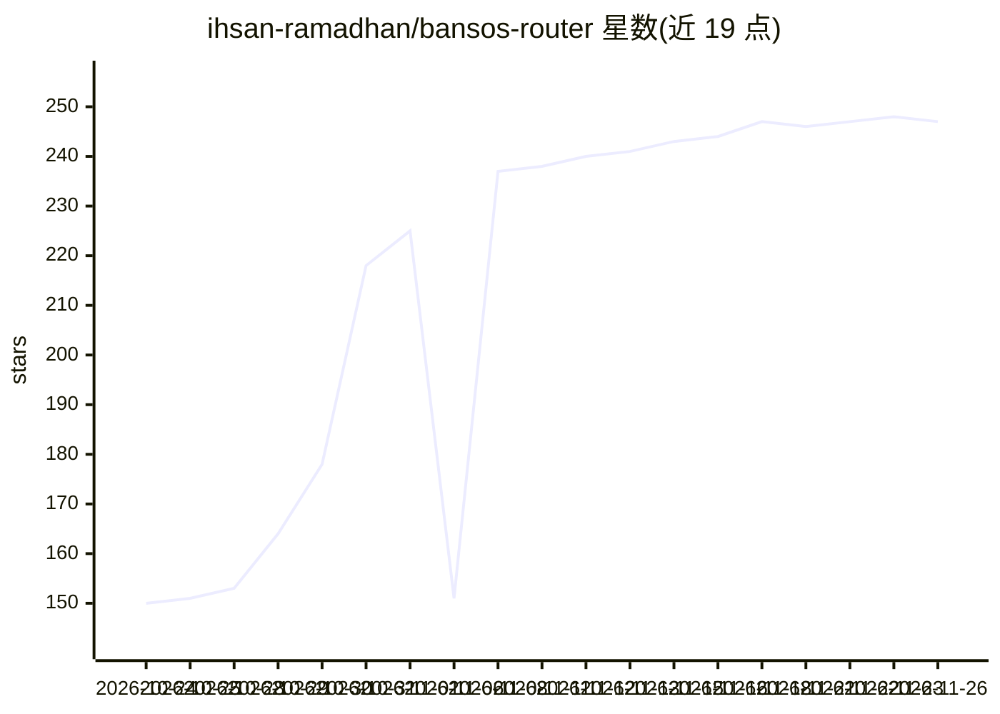

# ihsan-ramadhan/bansos-router

⭐ 247 · TypeScript · GPL-3.0 · 推送 2026-11-25 · [GitHub](https://github.com/ihsan-ramadhan/bansos-router) · [官网](https://ihsan-ramadhan.github.io/bansos-router/) · 个人维护

**本地免费编程模型路由守护进程：一处端点接入多种 coding harness**

运行于 127.0.0.1:17070 的本地守护进程，提供 OpenAI Chat Completions、Anthropic Messages 与 OpenAI Responses 三种协议端点，使各类编程助手（claude-code、opencode、aider、cline 等）无需账号与 API key 即可使用 OpenCode Zen、KiloCode、LLM7、OVHcloud 的免费额度。内置故障转移：出错模型进入冷却期，请求按推理模式、消息格式能力与上下文窗口匹配重试到其他上游模型。提供模型目录、延迟检测、用量统计、请求日志、仪表盘与安全模式，通过 npm 安装，也支持 Docker 部署。

## 筛选速览

| 维度 | 判定 | 备注 |
|---|---|---|
| AI 角色 | `ai-ecosystem` | LLM/agent 周边工具 |
| 许可风险 | `viral` | GPL-3.0 |
| 部署形态 | `self-host` | docker 或自建部署 |
| 模型依赖 | — | README 未给出锁定关系 |
| 硬件要求 | — | 无带数字的原话,不猜 |
| 安装摩擦 | `low` | 无编译、无系统依赖或容器化 |
| 成熟度 | — | 结构信号不足 |

## 能力要点

- 单一本地端点同时提供 OpenAI Chat Completions、Anthropic Messages、OpenAI Responses 协议
- 免费模型故障转移：按推理模式/消息格式/上下文窗口（不低于 90%）匹配重试
- bansos setup 一条命令写入 10 余种 harness 的配置，支持 --dry-run 与 --undo
- 本地仪表盘：模型目录、实时延迟、健康过滤、用量统计与请求日志

## 适用场景

- 不注册账号给 claude-code、opencode 等编程助手接入免费模型
- 为多个编程工具统一管理本地模型端点与配置
- 某免费模型限流时自动切换到其他上游的可用模型

## 场景标签

`模型网关` · 领域:Agent 开发

## 证据(README 行号)

> L16: One daemon on `127.0.0.1:17070` that speaks OpenAI Chat Completions, Anthropic Messages and OpenAI Responses, so an
> L49: Pin the models you want with `--model <id>`, or narrow a set with `--models <id,...> --upstream <id,...>`; `--dry-r

## 星数曲线

2026-10-24 150 → 2026-11-26 247（+97）

---
*卡片 v1 · prompt 1.4 · 生成 2026-11-26 · 置信度 high · 依据 README sha `410aa364e283` · [字段定义](../../DATASET.md)*
